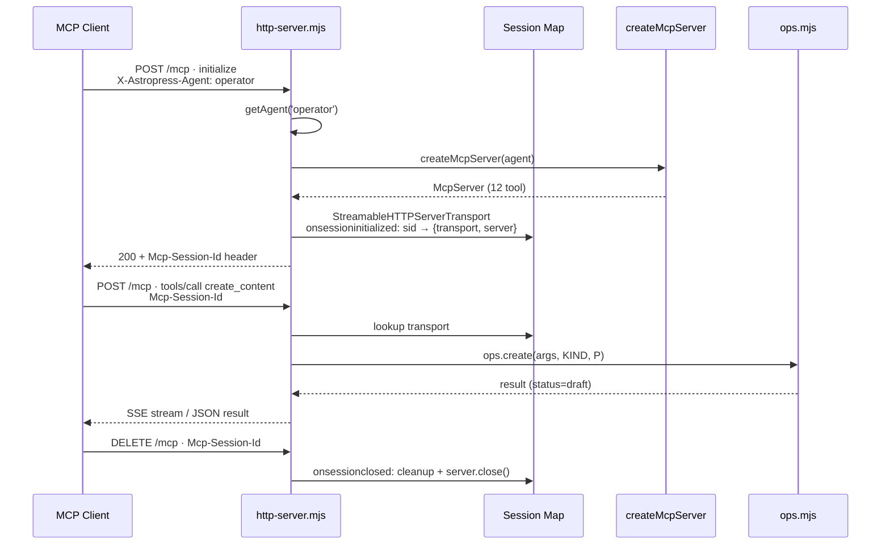

# P2.3 — MCP Streamable HTTP Transport (stdio korunarak)

- **Tarih:** 2026-11-12
- **Durum:** Tasarım onaylandı → spec review bekliyor
- **Faz:** P2.3 (AstroPress agent-native CMS)
- **Yazar:** Yusuf KEF <kefyusuf@gmail.com>
- **Sınıflandırma:** architectural (brainstorming HARD-GATE: onay olmadan implementasyon yok)

## 1. Bağlam

AstroPress'in MCP köprüsü bugün iki entrypoint'ten oluşur:

- `mcp/server.mjs` — **stdio** MCP sunucusu. Module-load'da tek `McpServer` kurar, 12 tool kaydeder,
  `StdioServerTransport` ile bağlanır. Kimlik `ASTROPRESS_AGENT` env'inden (`getAgent()`, varsayılan
  `content-studio`); `KIND = perms.publish ? 'human' : 'agent'`. Tool handler'ları `agent`/`P`/`KIND`
  module-level singleton'larına closure ile bağlıdır.
- `mcp/http.mjs` — **bespoke admin REST köprüsü** (`node:http`, :4322, loopback). Admin UI + `/site/`
  önizleme + `/api/*` servis eder; `HUMAN.perms` ile çalışır. MCP protokolü **değildir**.

Ortak iş mantığı `mcp/ops.mjs` (guardrail + RBAC, tek kaynak), kimlik `mcp/auth.mjs` (`agents.json`
registry), site config `mcp/config.mjs` (committed `sites.json`). Kurulu SDK **1.32.2** hem legacy
`SSEServerTransport` (deprecated) hem modern `StreamableHTTPServerTransport` sunar; `@hono/node-server`
2.1.7 ve client transport'ları (`SSEClientTransport`, `StreamableHTTPClientTransport`) hazırdır → **yeni
bağımlılık gerekmez**.

**Sorun:** stdio tek-process/tek-agent varsayar; uzak MCP client'ları tek sunucuya çok oturumla bağlanamaz.
P2.3, stdio'yu koruyarak MCP protokolünü HTTP üzerinden açar.

## 2. Hedefler / hedef-dışı

**Hedefler**
- MCP protocol'ünü Streamable HTTP transport ile HTTP üzerinden sunmak (tek `/mcp` endpoint).
- stdio entrypoint'ini **davranış-koruyan** şekilde korumak (mevcut 23-kontrol smoke yeşil kalır).
- Oturum-başı agent kimliği + sunucu-tarafı RBAC/guardrail'i HTTP'de de zorunlu kılmak.
- Paylaşılan `createMcpServer(agent)` factory'si ile stdio + HTTP tek tool-tanım kaynağını paylaşsın.
- Admin REST köprüsünü (`http.mjs`) **değiştirmemek** (regression-safe).

**Hedef-dışı (bu fazda yok)**
- Token/OAuth kimlik doğrulama (Faz 2). Production auth, TLS/reverse-proxy arkasında non-loopback.
- Resumability / `EventStore`, rate-limit, çok-instance yatay ölçek (Faz 3).
- MCP content-ops ile NestJS sites-registry subsystem'lerinin birleştirilmesi (Faz 4).
- Legacy `SSEServerTransport` (deprecated; yalnız Streamable HTTP).
- Admin UI'ın MCP protocol'üne taşınması (admin REST olduğu gibi kalır).

## 3. Onaylanan kararlar

| # | Karar | Seçim | Gerekçe |
|---|---|---|---|
| 1 | Transport flavor | **Streamable HTTP** | Güncel MCP spec (2025-03-26+), SDK'da deprecated değil; tek endpoint + built-in session; server→client streaming hâlâ SSE → "HTTP-SSE" anlamı korunur |
| 2 | HTTP kimliği | **Header agent id** (`X-Astropress-Agent`) | Mevcut `agents.json` registry + RBAC aynen korunur, yeni credential sistemi yok; env'deki trust modeliyle tutarlı; loopback-bound |
| 3 | Topoloji | **Yeni entrypoint + port** (`mcp/http-server.mjs`, :4323) | İzolasyon, tek sorumluluk; admin `http.mjs` değişmez; stdio + admin REST + MCP-HTTP üç bağımsız entrypoint |

## 4. Mimari

```mermaid
flowchart TD
  SC["Stdio client<br/>(smoke.mjs)"] -->|StdioServerTransport| S["mcp/server.mjs<br/>stdio · İNCELİR"]
  HC["HTTP client<br/>StreamableHTTPClientTransport"] -->|"POST/GET/DELETE /mcp<br/>X-Astropress-Agent"| H["mcp/http-server.mjs<br/>:4323 · YENİ"]
  S --> F["mcp/factory.mjs<br/>createMcpServer(agent)<br/>YENİ · 12 tool"]
  H -->|per-session| F
  F --> OPS["mcp/ops.mjs<br/>guardrail + RBAC<br/>DEĞİŞMEZ"]
  F --> AUTH["mcp/auth.mjs<br/>getAgent / agents.json"]
  F --> CFG["mcp/config.mjs<br/>sites.json"]
  H -.->|getAgent(header)| AUTH
  A["mcp/http.mjs<br/>:4322 admin REST<br/>DEĞİŞMEZ"] --> OPS
```

**İzolasyon ilkesi:** her ünite tek amaçlı, arayüzü net, bağımsız test edilebilir:
- `factory.mjs`: bir agent'a bağlı MCP sunucusu üretir. Arayüz: `createMcpServer(agent) → McpServer`.
- `http-server.mjs`: HTTP transport + oturum yaşam döngüsü + header kimlik.
- `server.mjs`: stdio entrypoint (factory'yi kullanır, ince).

## 5. Foundation refactor (ilk katman, davranış-koruyan)

**YENİ `mcp/factory.mjs`**
```
createMcpServer(agent) → McpServer
  agent = { id, name, perms }
  KIND  = agent.perms.publish ? 'human' : 'agent'
  P     = agent.perms
  new McpServer({ name: 'astropress', version: '0.1.0' })
  12 tool kaydı (mevcut server.mjs ile BİREBİR aynı şema/description/handler):
    whoami, list_content, read_content, create_content, update_content,
    delete_content, request_publish, approve_task, reject_task,
    list_tasks, run_build, audit_log
  handler'lar ops.* çağırır; create/update/delete/approve/reject → (args, KIND, P)
  return server
```
- `col = z.enum(['blog','products','pages'])`, `txt(obj)` helper'ları factory'ye taşınır.
- `locales` `config.mjs`'ten okunur (create/update şemalarında `lang: z.enum(locales)`).
- Guardrail şemaları değişmez: create/update'te `status` YOK; price/stock şemada var ama commerce yetkisi sunucuda zorunlu.

**MODIFIED `mcp/server.mjs`** (ince entrypoint)
```
import { createMcpServer } from './factory.mjs';
import { getAgent } from './auth.mjs';
import { StdioServerTransport } from '@modelcontextprotocol/sdk/server/stdio.js';
const server = createMcpServer(getAgent());
await server.connect(new StdioServerTransport());
```

**Kanıt (bracket):** mevcut stdio `smoke.mjs` **23 kontrol değişmeden yeşil**. Factory refactor'ünün
davranış-koruyan olduğunun regresyon kanıtı. Root unit (30) + backend (63) + build (12) etkilenmez.

## 6. HTTP entrypoint (`mcp/http-server.mjs`)

**Sunucu:** `node:http` (mevcut `http.mjs` stiliyle tutarlı; express gerekmez — SDK transport node:http uyumlu).
- Port: `Number(process.env.MCP_PORT || 4323)`.
- Host: `process.env.HOST || '127.0.0.1'` (loopback; container'da `0.0.0.0` override).
- DNS rebinding: birincil sınır **loopback bind** (`http.mjs` ile aynı). Defense-in-depth: `Host` header
  `localhost`/`127.0.0.1`/`[::1]` allowlist'inde değilse **403**. Container'da (`HOST=0.0.0.0`)
  `MCP_ALLOW_ANY_HOST=1` ile kontrol devre-dışı bırakılır. SDK deprecated option'ları yerine dış kontrol deseni.

**Endpoint'ler** (hepsi `transport.handleRequest(req, res, parsedBody)`):
| Method | Path | Amaç |
|---|---|---|
| POST | `/mcp` | client→server mesajları (initialize, tools/call, ...) |
| GET | `/mcp` | server→client SSE stream (notifications) |
| DELETE | `/mcp` | oturum sonlandırma |

**Body:** `readBody(req)` — 1MB limitli JSON parse (`http.mjs` deseni), `parsedBody` olarak transport'a
verilir. (`parsedBody` verildiğinde SDK'nın `maxRequestBodySize`'ı uygulanmaz; kendi 1MB sınırımız geçerli.)

**Stateful session yönetimi** (SDK option'ları, ground-truth `webStandardStreamableHttp.d.ts`):
```
transports = {}   // sessionId → { transport, server }

POST /mcp:
  sid = req.headers['mcp-session-id']
  entry = sid ? transports[sid] : undefined
  if (!entry):                       // yeni oturum (initialize)
    agentId = req.headers['x-astropress-agent'] || 'content-studio'
    agent   = getAgent(agentId)      // bilinmeyen → throw → 400
    server  = createMcpServer(agent)
    transport = new StreamableHTTPServerTransport({
      sessionIdGenerator: () => randomUUID(),
      onsessioninitialized: (id) => { transports[id] = { transport, server }; },
      onsessionclosed:      (id) => { delete transports[id]; server.close(); },
    })
    transport.onclose = () => { if (transport.sessionId) delete transports[transport.sessionId]; server.close(); }
    await server.connect(transport)
    await transport.handleRequest(req, res, body)
  else:
    await entry.transport.handleRequest(req, res, body)

GET / DELETE /mcp:
  sid = req.headers['mcp-session-id']; entry = transports[sid]
  yoksa SDK 404/400; varsa entry.transport.handleRequest(req, res)
```
- `enableJsonResponse` default **false** (SSE stream tercih edilir → "HTTP-SSE" doğası).
- `eventStore` verilmez (resumability Faz 3).
- Yeni oturum yalnız `Mcp-Session-Id` olmayan POST'ta oluşur; SDK `handleRequest` protokol doğrulamasını
  yapar (non-init session'sız istek → 400, geçersiz session → 404).

**Kimlik bağlama:** agent **initialize'da** (oturum oluşturulurken) header'dan seçilir, oturum boyunca sabit.
`whoami` o oturumun agent'ını döner. **auto-HUMAN YOK** → guardrail korunur: publish yetkisiz agent
approve/reject kullanamaz; yalnız publish yetkili kimlik (operator) 'human' sayılır.

## 7. Veri akışı



## 8. Hata yönetimi

| Durum | Davranış |
|---|---|
| Bilinmeyen agent header (`getAgent` throw) | **400** (initialize'da), mesaj: "Bilinmeyen agent: ..." |
| Geçersiz/eksik `Mcp-Session-Id` (non-init) | SDK otomatik **404/400** |
| RBAC reddi / domain doğrulama | MCP tool result `isError` (stdio ile aynı; ops'tan gelir) |
| Bozuk JSON / >1MB gövde | **400** |
| Transport hatası | `transport.onerror` → oturum cleanup |
| DNS rebinding / yanlış Host | loopback bind + Host allowlist → **403** |

## 9. Test stratejisi (TDD)

**YENİ `mcp/smoke-http.mjs`** — HTTP sunucusunu spawn eder (rastgele/`MCP_PORT` port),
`StreamableHTTPClientTransport` + `requestInit.headers['X-Astropress-Agent']` ile bağlanır. RED (sunucu
yok / client bağlanamaz) → GREEN. Koşulan kontroller (stdio smoke'u HTTP'de yansıtır):
- **Guardrail zinciri:** create→draft · run_build→draft dist'te YOK · request_publish→approval kuyruğu ·
  approve_task→published · run_build→dist'te VAR · delete→dist'ten gider · audit_log kayıt.
- **RBAC:** content-studio create allowed / commerce denied / approve denied; commerce-bot create denied /
  price allowed; reader create+delete denied; reddedilenler audit'te.
- **i18n:** EN create `lang=en`+`translationOf` · `/en/blog/` altına build · TR rotasına sızmaz.
- **HTTP'ye özgü:** `whoami` header agent'ını döner · bilinmeyen agent header → 400 · iki farklı agent
  ayrı oturumda izole (session isolation) · DELETE sonrası oturum kapanır.

**Korunan bracket'ler (değişmeden yeşil):** stdio smoke **23** · root unit **30** · backend **63** · build **12**.

**CI:** `smoke-http`'in root `ci` script'ine + `.github/workflows/ci.yml`'a eklenmesi **CI değişikliği = ayrı onay**.

## 10. Tradeoff tablosu

| Karar | Seçim | Alternatif | Tradeoff |
|---|---|---|---|
| Transport | Streamable HTTP | Legacy SSE | Güncel spec, deprecated değil, tek endpoint + built-in session; eski client uyumu daha dar |
| Kimlik | Header agent id | Token / OAuth | Registry+RBAC korunur, yeni credential yok; loopback trust boundary, production auth Faz 2 |
| Topoloji | Yeni entrypoint :4323 | http.mjs mount | İzolasyon + admin regression-safe; +1 port/process |
| Session | Stateful in-memory | Stateless | SDK built-in session; resumability yok (Faz 3); basit |
| Server | `createMcpServer(agent)` factory | Module-level singleton | stdio+HTTP paylaşır, per-session agent; davranış-koruyan refactor |
| Body | kendi readBody (1MB) | SDK maxRequestBodySize | parsedBody verince SDK limiti uygulanmaz; http.mjs ile tutarlı |

## 11. Ölçeklenebilirlik fazları

- **Faz 1 (P2.3, şimdi):** Streamable HTTP, stateful in-memory session, header kimlik, loopback, tek process, local dev.
- **Faz 2:** Token/OAuth (SDK `server/auth` middleware), TLS/reverse-proxy arkasında non-loopback binding.
- **Faz 3:** `EventStore` ile resumability, rate-limit (SDK `express-rate-limit`), çok-instance/yatay ölçek (shared session store / sticky sessions).
- **Faz 4:** MCP content-ops ile NestJS sites-registry subsystem'lerinin yakınsaması (ayrı mimari karar).

## 12. Dosya envanteri

| Dosya | Durum | Sorumluluk |
|---|---|---|
| `mcp/factory.mjs` | YENİ | `createMcpServer(agent)` — 12 tool, paylaşılan |
| `mcp/server.mjs` | MODIFIED | stdio entrypoint (factory kullanır, incelir) |
| `mcp/http-server.mjs` | YENİ | HTTP transport + session + header kimlik |
| `mcp/smoke-http.mjs` | YENİ | HTTP smoke (guardrail+RBAC+i18n+HTTP-specific) |
| `package.json` | MODIFIED | `mcp:http` (+ `smoke:http`) script |
| `README.md` | MODIFIED | HTTP transport, port, header, fazlar |
| `docker-compose.yml` | **GATED** | 4323 expose + mcp:http servis (ayrı onay) |
| `.github/workflows/ci.yml` + root `ci` | **GATED** | smoke-http ekle (ayrı onay) |

## 13. Kabul kriterleri (doğrulanabilir)

1. `createMcpServer(agent)` 12 tool'lu `McpServer` döner; stdio `server.mjs` bunu kullanır.
2. stdio `smoke.mjs` **23/23** yeşil (refactor davranış-koruyan).
3. `npm run mcp:http` :4323'te (loopback) başlar; `POST/GET/DELETE /mcp` çalışır.
4. `X-Astropress-Agent` header'ı oturum kimliğini belirler; `whoami` o agent'ı döner; bilinmeyen agent → 400.
5. Guardrail HTTP'de korunur: agent create→draft, self-approve YOK; yalnız publish yetkili approve eder.
6. RBAC HTTP'de zorunlu: content-studio/commerce-bot/reader izin/red senaryoları stdio ile aynı.
7. i18n HTTP'de: EN içerik `/en/blog/` altına build olur, TR rotasına sızmaz.
8. İki farklı agent ayrı oturumda izole; DELETE sonrası oturum kapanır (session map temizlenir).
9. `smoke-http.mjs` tüm kontrolleri yeşil; root unit 30 + backend 63 + build 12 değişmeden yeşil.
10. Admin `http.mjs` (:4322) değişmez, admin UI regression yok.

## 14. Onay kapıları / kapsam-dışı

- **Spec commit'i:** ayrı düz-metin onayı (onaysız git yazması yok).
- **Her implementasyon katmanı:** ayrı commit onayı (foundation refactor → HTTP transport → smoke-http → README).
- **CI değişikliği** (`ci` script + workflow): ayrı onay.
- **Docker compose değişikliği** (4323 + servis): ayrı onay.
- Kimlik metadata: `Yusuf KEF <kefyusuf@gmail.com>` (noreply yok; git config değiştirilmez).
- Remote yok → push/PR yok.

## 15. Implementasyon notları (writing-plans'ta doğrulanacak)

- SDK stateful pattern: `onsessioninitialized` ile session map'e kayıt, `onsessionclosed`/`onclose` ile cleanup.
  Exact wiring SDK'nın dokümante stateful örneğini izler; implementasyonda `streamableHttp.js` akışı teyit edilir.
- `StreamableHTTPClientTransport` client tarafında `requestInit: { headers: { 'X-Astropress-Agent': id } }`
  ile initialize'da kimlik taşır; `Mcp-Session-Id` SDK tarafından otomatik yönetilir.
- `randomUUID` `node:crypto`'dan.
- Factory'ye taşırken tool şema/description/handler'ları birebir korunur (diff ile doğrulanır).