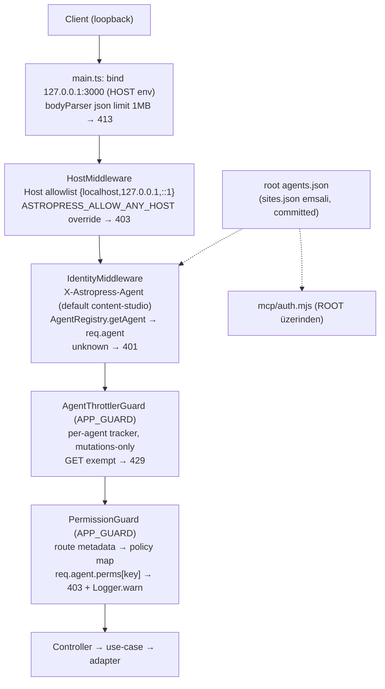
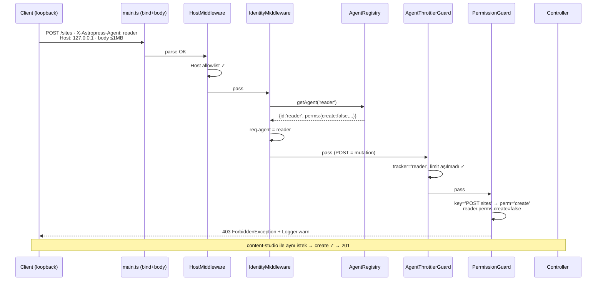

# D1 — Backend Security Perimeter (MCP modelinin NestJS portu)

- **Tarih:** 2026-11-20
- **Durum:** Tasarım onaylandı (3 bölüm) → spec review bekliyor
- **Faz:** P2.4 Faz-2 hardening backlog → Group D → **D1** (security perimeter)
- **Yazar:** Yusuf KEF <kefyusuf@gmail.com>
- **Sınıflandırma:** architectural (brainstorming HARD-GATE: onay olmadan implementasyon yok)
- **İlişkili:** D2 (builds retention + queue-bound, bounded, sonra) · Group E (BullMQ + Redis, sonra)

## 1. Bağlam

AstroPress iki paralel yüzey içerir:

- **MCP köprüsü (`mcp/`)** — agent-facing, doğrudan file store (`store.mjs`) üzerinde çalışır,
  backend HTTP'yi **çağırmaz**. Güvenlik modeli kurulu: `http-server.mjs` loopback bind
  (`HOST=127.0.0.1`) + Host allowlist (`{localhost,127.0.0.1,::1}`, `MCP_ALLOW_ANY_HOST=1` override)
  + `readBody` 1MB limit; kimlik `X-Astropress-Agent` header (default `content-studio`) → `auth.mjs`
  `getAgent` → `agents.json` registry; RBAC `ops.mjs` `deny(actor,perms,key,detail)` per-op
  (create→`create`, update→`edit` [+commerce], remove→`delete`, approve/reject→`publish`),
  reddedilen eylem audit'e yazılır.
- **NestJS backend (`backend/`)** — strangler-migration hedefi, clean architecture (ports/adapters),
  TDD. Bugün **security perimeter YOK**: `main.ts` `app.listen(port)` → `0.0.0.0` bind, host guard yok,
  kimlik yok, RBAC yok, rate-limit yok, express default body limit (~100kb).

**Tek-kaynak emsali (kurulu):** committed kök `sites.json`'ı MCP `config.mjs` (`ROOT` üzerinden) ve
backend `file-site.repository.ts` (`astro.config.mjs` işaretçisine yürüyerek kök bulma) birlikte okur.
Backend'de kök-bulma mekanizması + env test-seam (`ASTROPRESS_SITES_FILE`) deseni hazırdır.

**Sorun:** backend HTTP API loopback'te bile kimliksiz/yetkisiz/sınırsız — herhangi bir caller tüm
endpoint'leri çağırabilir, runaway agent sınırsız build tetikleyebilir. D1, MCP'nin kurulu güvenlik
modelini (host + authN + RBAC + body-limit) NestJS'e port eder ve per-agent rate-limit ekler.

## 2. Hedefler / hedef-dışı

**Hedefler**
- MCP güvenlik modelini backend'e port: loopback bind + Host allowlist, header-claim kimlik, RBAC, 1MB body-limit.
- Per-agent rate-limit (loopback'te per-IP çöker → agent-id keyed), mutations-only.
- `agents.json`'ı kök tek-kaynak config'e promote et (sites.json emsali), MCP + backend birlikte okusun.
- **Sites/Builds slice'larını DOKUNMADAN** (src + test) merkezi SecurityModule ile perimeter uygula.
- Mevcut regresyon bracket'ini yeşil tut (backend 117, root 30, MCP smoke).

**Hedef-dışı (bu fazda yok)**
- Gerçek token/OAuth/JWT kimlik (Faz-2+ roadmap; D1 header-claim port, loopback-trusted).
- Builds retention + queue-bound (D2, bounded, sonra).
- BullMQ + Redis durable queue (Group E; throttler storage Redis seam D1'de bırakılır).
- Full audit store (audit.json) — MCP concern; D1 yalnız `Logger.warn` security event.
- Publish/approve endpoint (backend'de yok; `publish` perm tipi reserved).
- Distributed/remote registry, multi-instance binding (Faz-2+; seam bırakılır).
- CI/Docker değişikliği (D1 yeni port/servis eklemez; throttler in-process, dep `npm install` ile gelir).

## 3. Onaylanan kararlar

| # | Karar | Seçim | Gerekçe |
|---|---|---|---|
| 1 | Kimlik modeli (authN) | **Header-claim port** (`X-Astropress-Agent`) | MCP modelini birebir taşır; loopback çevresinde header güvenilir, token/secret yok; gerçek token Faz-2+ |
| 2 | Registry tek-kaynak | **Kök `agents.json`** (sites.json emsali) | Nötr kök sahipliği, MCP+backend birlikte okur; foundation-first tek-kaynak; ~1 satır MCP churn |
| 3 | RBAC enforcement | **Merkezi Guard + policy map** | sites-freeze tam korunur (controller dokunulmaz), policy tek yerde denetlenebilir; MCP ops.mjs merkeziyetçiliğiyle tutarlı |
| 4 | Rate-limit | **@nestjs/throttler per-agent** | Idiomatic NestJS, Guard sistemiyle bütünleşik, Group E'de Redis storage swap (E-ready); yeni dep |
| 5 | builds POST perm | **`edit`** (MCP divergence) | Build operasyonel mutation; edit-yetkili agent build eder, read-only reader expensive build tetikleyemez (resource gap kapanır) |
| 6 | unknown agent HTTP | **401** (MCP divergence) | REST authN semantiği (`UnauthorizedException`); MCP 400 döner ama backend REST'de 401 doğru |

## 4. Mimari

**İstek yaşam döngüsü (perimeter pipeline):**



**Katman sorumlulukları:**
- **main.ts** (transport config): `app.listen(port, HOST||'127.0.0.1')` + body-limit 1MB. Production
  bootstrap; AppModule-boot testleri bunu görmez → perimeter testi bootstrap config'i replike eder.
- **Middleware** (SecurityModule `.configure`, guard'lardan ÖNCE): Host-check + Identity-extraction.
  Transport-seviye, `req.agent`'ı bağlar.
- **Guard'lar** (APP_GUARD, route-seviye): AgentThrottlerGuard (rate-limit) + PermissionGuard (RBAC).
  `req.agent`'ı middleware'den okur.

**Yeni `backend/src/security/` slice** (clean architecture: domain/infrastructure/interface):
- `domain/agent.ts` — `Agent {id,name,perms}`, `Perms {create,edit,delete,commerce,publish}` (boolean)
- `domain/errors.ts` — `UnknownAgentError`
- `infrastructure/agent-registry.ts` — `AgentRegistry`, `defaultAgentsFile()`, `AGENTS_FILE` Symbol
- `interface/host.middleware.ts`, `interface/identity.middleware.ts`, `interface/permission.guard.ts`,
  `interface/agent-throttler.guard.ts`, `interface/policy.ts`
- `security.module.ts` — ThrottlerModule.forRoot import, AGENTS_FILE factory + AgentRegistry + 2 APP_GUARD
  provider, NestModule.configure (2 middleware, `forRoutes('*')`)

**AppModule** yalnız `SecurityModule` import eder (mevcut SitesModule/BuildsModule/2 APP_FILTER korunur).
Sites/Builds modülleri/controller'ları **değişmez**. APP_GUARD + middleware global uygulanır → mevcut
HTTP testleri perimeter'i otomatik görür.

## 5. Registry & identity

**Kök promosyon:** `git mv mcp/agents.json → agents.json`. Registry şeması **değişmez** (5 agent):
`operator` (tüm perms), `content-studio` (create/edit/delete), `commerce-bot` (edit/commerce),
`seo-agent` (edit), `reader` (hiçbiri).

**MODIFIED `mcp/auth.mjs`** (~1 satır, config.mjs emsali):
```
import { ROOT } from './store.mjs';
const registry = JSON.parse(fs.readFileSync(path.join(ROOT, 'agents.json'), 'utf8'));
```
`getAgent`/`listAgents`/`HUMAN`/`AGENT_ID` davranışı değişmez. MCP smoke regresyon kanıtı.

**YENİ `AgentRegistry`** (MCP `getAgent`/`listAgents` + backend `defaultSitesFile` birebir emsali):
```
defaultAgentsFile(): string
  if (process.env.ASTROPRESS_AGENTS_FILE) return process.env.ASTROPRESS_AGENTS_FILE;  // test seam
  let dir = __dirname;
  while (!fs.existsSync(path.join(dir,'astro.config.mjs'))) { parent=dirname(dir); if(parent===dir)break; dir=parent; }
  return path.join(dir, 'agents.json');

AgentRegistry (@Injectable, @Inject(AGENTS_FILE) file)
  registry = JSON.parse(readFileSync(file))   // module-load'da bir kez
  getAgent(id): Agent  → registry[id] yoksa UnknownAgentError; varsa {id,name,perms}
  listAgents(): Agent[]
```

**IdentityMiddleware:** `req.headers['x-astropress-agent']` (express lowercase, case-insensitive) →
**default `content-studio`** (MCP parity, loopback-trusted, `publish:false` → self-publish yok).
`registry.getAgent(id)` → `req.agent = agent`. `UnknownAgentError` → **401** (`UnauthorizedException`).
- Ayrı `HUMAN` sabiti gerekmez: registry `operator` (tüm perms) human-equivalent. Backend'de publish/approve
  endpoint yok → `publish` perm D1 policy map'te kullanılmaz (gelecek endpoint'e reserved).

## 6. RBAC policy map (merkezi, fail-closed)

**PermissionGuard** Nest route metadata'sından key üretir → `policy.ts` map'ine bakar:
```
canActivate(context):
  req   = context.switchToHttp().getRequest()
  agent = req.agent                       // IdentityMiddleware garantiler
  method    = RequestMethod[Reflect.getMetadata('method', context.getHandler())]   // 'GET','POST','PUT'
  ctrlPath  = Reflect.getMetadata('path', context.getClass())                      // 'sites','builds'
  handlPath = Reflect.getMetadata('path', context.getHandler())                    // '',':id',':id/locales'
  key   = `${method} ${normalize(ctrlPath, handlPath)}`
  perm  = POLICY[key]
  if (perm === 'public') return true
  if (!perm)             throw ForbiddenException + Logger.warn   // unmapped → fail-closed
  if (!agent.perms[perm]) throw ForbiddenException + Logger.warn   // denied (hafif audit)
  return true
```

**Route→perm tablosu:**
| Route | Method | Perm | Gerekçe |
|---|---|---|---|
| `sites` | GET | public | read |
| `sites` | POST | `create` | site kaydı |
| `sites/:id` | GET | public | read |
| `sites/:id/locales` | PUT | `edit` | locale config |
| `builds` | POST | `edit` | build enqueue = operasyonel mutation (reader ✗) |
| `builds` | GET | public | read |
| `builds/:id` | GET | public | read |

- **Fail-closed:** map'te olmayan route → 403. Yeni endpoint'ler açıkça eklenmeli (accidental exposure önlenir).
- **builds POST → `edit`:** content-studio/commerce-bot/seo-agent/operator ✓, reader ✗. MCP `build(actor)`
  gate'sizdir; backend perimeter reader-resource gap'i kapatır (bilinçli divergence). Yeni perm eklenmez
  (`edit` reuse, registry şeması değişmez). `publish` alternatifi çok katı (agent'lar `publish:false` →
  content-studio build edemez) → reject.
- **Denied → 403** (`ForbiddenException`, built-in filter) + `Logger.warn`. Full audit store D1 kapsamı dışı.

## 7. Rate-limit (@nestjs/throttler v6, per-agent)

- `ThrottlerModule.forRoot([{ ttl: 60000, limit: 60 }])` — fixed-window, **default 60 mutation/dk/agent**,
  `ASTROPRESS_RATE_LIMIT` env override (limit). Coarse runaway bound (D2 queue-bound ile complementary).
- **AgentThrottlerGuard extends ThrottlerGuard:**
  - tracker = `req.agent.id` (loopback'te tüm istekler 127.0.0.1 → per-IP çöker, per-agent şart).
  - `shouldSkip(context)` override → `req.method === 'GET'` → skip (**GET exempt**, read/poll cheap;
    mutations-only throttle).
  - → **429** (`ThrottlerException`, built-in filter).
- **Mevcut testler yeşil:** her test boot'u fresh AppModule → fresh in-memory ThrottlerStorage → sayaç
  sıfırlanır; test başına az mutation (sites POST+PUT=2, builds POST=1 + GET poll exempt) < 60.
- **E-ready:** storage provider Redis'e swap (Group E), guard/config değişmez.

## 8. Body-limit & host

**Body-limit 1MB** (MCP parity), main.ts:
```
const app = await NestFactory.create(AppModule, { bodyParser: false });
app.useBodyParser('json', { limit: '1mb' });   // Nest 11 API
```
Oversized → **413** (express `entity.too.large`). Perimeter testi aynı parser config'ini replike eder;
mevcut slice testleri `createNestApplication` (default ~100kb, küçük body) → etkilenmez.

**Host:**
- main.ts `app.listen(port, process.env.HOST || '127.0.0.1')` (bind, primary defense; MCP parity).
- **HostMiddleware:** Host-header allowlist `{localhost,127.0.0.1,::1}` (case-insensitive, IPv6 bracket
  parse, MCP `hostAllowed` emsali) → **403**; `ASTROPRESS_ALLOW_ANY_HOST=1` override (kontrol devre-dışı).
- **Ordering notu:** NestJS body parser middleware'den önce → oversized body parse (≤1MB) sonra Host 403.
  MCP host'u readBody'den önce kontrol eder. Bind primary defense, Host-check secondary (DNS-rebinding);
  1MB parse cost'i boundlar. Kabul edilebilir minor divergence.

## 9. Veri akışı



## 10. Hata yönetimi

| Durum | Davranış |
|---|---|
| Yanlış Host (allowlist dışı) | **403** (HostMiddleware) |
| Oversized body (>1MB) | **413** (express parser) |
| Bilinmeyen agent header | **401** (`UnauthorizedException`, IdentityMiddleware) |
| Eksik agent header | default `content-studio` (MCP parity, reject yok) |
| RBAC reddi (perms[key] false) | **403** (`ForbiddenException`) + `Logger.warn` |
| Unmapped route (policy'de yok) | **403** fail-closed + `Logger.warn` |
| Rate-limit aşımı (mutation) | **429** (`ThrottlerException`) |
| Domain doğrulama / not-found | mevcut filter'lar (400/404) değişmez |

## 11. Test stratejisi (TDD)

Mevcut desen: `npm run build && node --test --test-concurrency=1 "dist/test/**/*.spec.js"` (tsc src+test
derler → type hataları build/RED'de yüzeye çıkar). Testler AppModule boot eder.

**YENİ `backend/test/security/`:**
- `agent-registry.spec.ts` (unit): getAgent known→{id,name,perms}, unknown→UnknownAgentError,
  listAgents→5, defaultAgentsFile (`ASTROPRESS_AGENTS_FILE` temp override + astro.config yürümesi).
  RED: export yok → TS2305 build fail.
- `policy.spec.ts` (unit, pure lookup): route→perm eşlemesi, public GET, fail-closed default (unmapped→deny).
- `perimeter.http.spec.ts` (integration, ana kapsam): AppModule boot + `ASTROPRESS_AGENTS_FILE` temp
  fixture + `ASTROPRESS_STATE` temp + `BUILD_RUNNER` fake override (builds.http.spec.ts emsali, real astro
  spawn yok). Body-limit testi main.ts parser config'ini replike eder. Vakalar:
  - **host:** evil→403, localhost/127.0.0.1→pass, `ASTROPRESS_ALLOW_ANY_HOST=1`→evil pass.
  - **identity:** no header→content-studio default (POST sites→201), unknown→401, reader/operator.
  - **RBAC:** reader GET sites→200 / POST sites→403, content-studio POST→201, seo-agent PUT locales→200,
    reader PUT→403, content-studio POST builds→201/202, reader POST builds→403, commerce-bot POST sites→403.
  - **rate-limit:** düşük env limit (ör. 2)→429, GET poll exempt (çok GET→429 yok), per-agent izolasyon
    (A throttled, B geçer).
  - **body:** >1MB POST→413.

**Mevcut testler NEDEN yeşil kalır (değişiklik GEREKMEZ):**
- sites HTTP (9+1 skip) / builds HTTP (5): AppModule boot → SecurityModule aktif. Header yok → default
  content-studio (create/edit/delete ✓). POST sites→create ✓, PUT→edit ✓, POST builds→edit ✓, GET→public ✓.
  Host 127.0.0.1 ✓. Rate-limit: test başına ≤4 mutation < 60, fresh boot = fresh storage ✓. GET poll
  exempt ✓. AgentRegistry committed kök agents.json okur (config, mutate yok) ✓.
- sites/builds domain/application/worker/file/runner unit: HTTP boot etmez → perimeter etkilemez ✓.

**Regresyon bracket tahmini:** mevcut 117 (74 sites + 43 builds, 106 pass / 11 skip) YEŞİL + ~25 yeni
security testi → backend ~142. MCP smoke (auth.mjs ROOT path) + root 30/30 YEŞİL (agents.json mv root
build'i etkilemez — root build sites.json okur). Her katmanda bracket.

## 12. Tradeoff tablosu

| Karar | Seçim | Alternatif | Tradeoff |
|---|---|---|---|
| Kimlik | header-claim | token/OAuth | loopback basitlik + MCP parity vs gerçek authN (Faz-2+) |
| Registry | kök agents.json | mcp/ yerinde / kopya | tek-kaynak (sites.json emsali) vs MCP churn (~1 satır + mv) |
| RBAC | merkezi policy map | @RequirePerm decorator | sites-freeze + merkezi denetim vs per-endpoint görünürlük |
| builds POST | edit-gated | ungated (MCP parity) | reader-resource gap kapanır vs MCP divergence |
| Rate-limit | throttler per-agent | custom / express-rate-limit | idiomatic + E-ready Redis vs yeni dep |
| RL boyut | per-agent mutations-only | per-IP / all-methods | loopback per-IP çöker + poll-friendly vs read-flood (GET cheap) |
| unknown agent | 401 | 400 (MCP parity) | REST authN semantiği vs MCP birebir |
| body/host | main.ts config | AppModule middleware | production transport config vs testability seam (perimeter test replike) |

## 13. Ölçeklenebilirlik fazları & seam'ler

| Faz | Kapsam | D1'de bırakılan seam |
|---|---|---|
| **D1 (şimdi)** | single-instance, loopback perimeter, header-claim, in-memory throttler, kök agents.json | — |
| **D2 (sonra, bounded)** | builds retention + queue-bound (resource cap) | rate-limit ile complementary |
| **E (later)** | BullMQ + Redis durable queue | **ThrottlerStorage → Redis swap** (guard/config değişmez); yeni dep + Redis Docker ayrı onay |
| **Faz-2+ (roadmap)** | gerçek token/OAuth, distributed registry, multi-instance | **IdentityMiddleware → token-validation swap**; **AgentRegistry → remote adapter swap**; HOST env bind override (zaten) |

D1 seam'leri bilinçli: identity/registry/storage her biri tek noktadan değiştirilebilir
(middleware/service/provider), pipeline bozulmaz.

## 14. Dosya envanteri

| Dosya | Durum | Sorumluluk |
|---|---|---|
| `agents.json` (kök) | **MOVE** (`git mv mcp/agents.json`) | tek-kaynak agent registry (sites.json emsali) |
| `mcp/auth.mjs` | MODIFIED (~1 satır) | `__dirname` → `ROOT` path |
| `backend/src/security/domain/agent.ts` | YENİ | Agent, Perms tipleri |
| `backend/src/security/domain/errors.ts` | YENİ | UnknownAgentError |
| `backend/src/security/infrastructure/agent-registry.ts` | YENİ | AgentRegistry, defaultAgentsFile, AGENTS_FILE |
| `backend/src/security/interface/host.middleware.ts` | YENİ | Host allowlist → 403 |
| `backend/src/security/interface/identity.middleware.ts` | YENİ | header → req.agent, unknown → 401 |
| `backend/src/security/interface/permission.guard.ts` | YENİ | route metadata → policy → 403 |
| `backend/src/security/interface/agent-throttler.guard.ts` | YENİ | per-agent tracker, GET exempt → 429 |
| `backend/src/security/interface/policy.ts` | YENİ | route→perm map (fail-closed) |
| `backend/src/security/security.module.ts` | YENİ | perimeter wiring (middleware + guards + registry) |
| `backend/src/app.module.ts` | MODIFIED | SecurityModule import |
| `backend/src/main.ts` | MODIFIED | bind HOST + body-limit 1MB |
| `backend/package.json` | MODIFIED | +@nestjs/throttler (yeni dep) |
| `backend/test/security/agent-registry.spec.ts` | YENİ | registry unit |
| `backend/test/security/policy.spec.ts` | YENİ | policy lookup unit |
| `backend/test/security/perimeter.http.spec.ts` | YENİ | perimeter integration |
| `README.md` | MODIFIED | yol metni + operational note accuracy (I2 done, 117/43, D1) + roadmap |
| `admin/index.html` | MODIFIED | `mcp/agents.json` → kök `agents.json` yol metni |
| `backend/src/sites/**`, `backend/src/builds/**`, `src/content/**` | **DOKUNULMAZ** | freeze |
| `backend/test/sites/**`, `backend/test/builds/**` | **DOKUNULMAZ** | freeze-lift gerekmez |
| CI / docker-compose | **DOKUNULMAZ** | D1 yeni port/servis yok |

## 15. Freeze uyumu

**SIFIR sites/builds dokunuşu** (src VE test). B'deki narrow test-lift bile GEREKMEZ — merkezi
SecurityModule AppModule üzerinden uygulanır, default content-studio + GET-exempt + fresh storage mevcut
HTTP testlerini yeşil tutar. `sites/src`, `sites/test`, `builds/src`, `builds/test`, `src/content`
dokunulmaz. `mcp/` frozen değil → `auth.mjs` 1-satır + `agents.json` mv serbest; `ops.mjs`/`store.mjs`/
`http-server.mjs` dokunulmaz. **D1 freeze-lift gerektirmez.**

## 16. Kabul kriterleri (doğrulanabilir)

1. Kök `agents.json` committed; `mcp/auth.mjs` `ROOT` üzerinden okur; MCP smoke yeşil (davranış-koruyan).
2. `AgentRegistry.getAgent` known→Agent, unknown→UnknownAgentError; `defaultAgentsFile` env override + astro.config yürümesi.
3. Backend `127.0.0.1` bind (HOST env); Host allowlist dışı → 403; `ASTROPRESS_ALLOW_ANY_HOST=1` override.
4. `X-Astropress-Agent` header kimliği belirler; eksik → content-studio default; unknown → 401.
5. RBAC zorunlu: reader POST sites/builds → 403, content-studio POST sites → 201, seo-agent PUT locales → 200; unmapped → 403 fail-closed.
6. builds POST `edit` gerektirir (reader ✗, content-studio ✓).
7. Per-agent rate-limit: mutation limit aşımı → 429; GET exempt; per-agent izolasyon.
8. Body >1MB → 413.
9. `perimeter.http.spec.ts` + `agent-registry.spec.ts` + `policy.spec.ts` yeşil; mevcut backend 117 + root 30 + MCP smoke değişmeden yeşil.
10. Sites/Builds src+test, src/content, CI, Docker **dokunulmamış** (diff ile doğrulanır).

## 17. Onay kapıları / kapsam-dışı

- **Spec commit'i:** ayrı düz-metin onayı (onaysız git yazması yok; tasarım onayı ≠ commit onayı).
- **Her implementasyon katmanı:** ayrı commit onayı (temel → authN → authZ → docs).
- **Yeni dep (@nestjs/throttler):** tasarım kararı #4 ile onaylandı; install implementation'da.
- **CI / Docker değişikliği:** D1 dokunmaz (gerekirse ayrı onay).
- Kimlik metadata: `Yusuf KEF <kefyusuf@gmail.com>` (noreply yok; git config değiştirilmez).
- Remote yok → push/PR yok. Plan `docs/superpowers/plans/` LOCAL/gitignored; spec committed.

## 18. Teslimat fazları (gated, writing-plans detaylandıracak)

1. **Temel:** agents.json kök promosi + mcp/auth.mjs ROOT + AgentRegistry + domain types + unit tests.
   Bracket: MCP smoke + registry tests + mevcut backend yeşil. → **GATED commit 1**
2. **authN perimeter:** SecurityModule + Host/Identity middleware + main.ts bind/body + perimeter
   host/identity/body tests. → **GATED commit 2**
3. **authZ perimeter:** PermissionGuard + policy + AgentThrottlerGuard + throttler dep + perimeter
   RBAC/rate-limit tests. → **GATED commit 3**
4. **Docs:** README/admin yol + operational note accuracy (I2 done, 117/43, D1 perimeter) + roadmap.
   → **GATED commit 4** (veya 3'e fold)

Her commit ayrı düz-metin onay ister. TDD red-green katman başına. Spec → onayla commit → self-review →
user spec review → writing-plans → implementation.

## 19. Implementasyon notları (writing-plans'ta doğrulanacak)

- **Nest route metadata:** `@Controller('sites')` class'a `path` metadata; `@Get/@Post/@Put` handler'a
  `path` + `method` (RequestMethod enum) metadata yazar. Exact değerler (`@Get()` path `'/'` mi `''` mi)
  implementasyonda teyit; `normalize()` leading/trailing slash strip + join. TDD perimeter testleri
  metadata extraction'ı end-to-end doğrular.
- **@nestjs/throttler v6 API:** `ThrottlerGuard` `getTracker(context)` + `shouldSkip(context)` protected
  override; `ThrottlerModule.forRoot([{ttl,limit}])` ttl birimi (v6 ms) teyit. Nest 11 compat (v6) doğrula.
- **Nest 11 body parser:** `NestFactory.create(AppModule,{bodyParser:false})` + `app.useBodyParser('json',
  {limit:'1mb'})` API teyit. Perimeter test boot'u aynı config'i replike eder (shared helper veya 2-satır).
- **Host parse:** MCP `hostAllowed` emsali — IPv6 bracket (`[::1]`) slice, `split(':')[0]`, lowercase.
- **AgentRegistry module-load read:** `defaultSitesFile` emsali senkron read; test seam
  `ASTROPRESS_AGENTS_FILE` (sites `ASTROPRESS_SITES_FILE` parity).
- **Logger:** `new Logger(Class.name)` internal field (constructor param DEĞİL — DI-free test construction
  korunur, build-worker emsali).