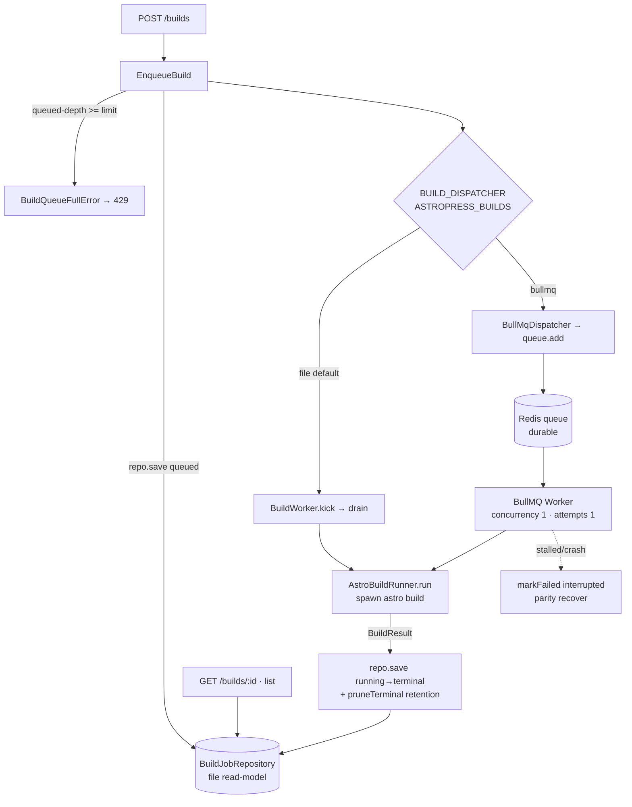
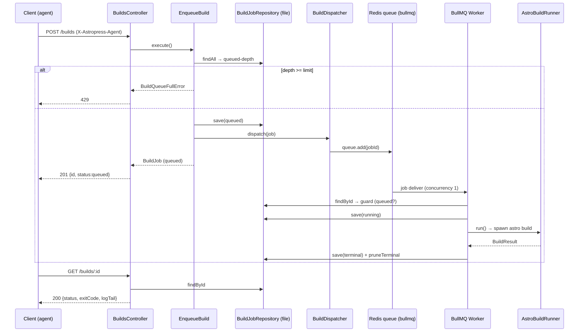
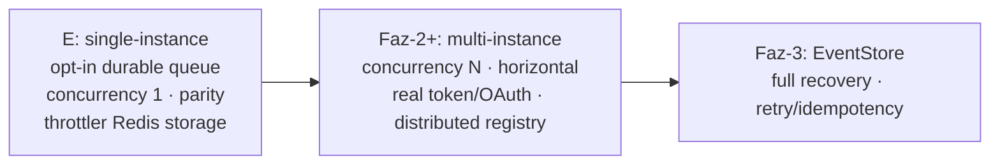

# E — Opt-in Durable Builds Engine (BullMQ + Redis)

- **Tarih:** 2026-11-23
- **Durum:** Tasarım onaylandı (4 foundational karar + tasarım bölümü) → spec review bekliyor
- **Faz:** P2.4 Faz-2 hardening backlog → Group D (D1+D2 COMPLETE) → **Group E** (durable queue)
- **Yazar:** Yusuf KEF <kefyusuf@gmail.com>
- **Sınıflandırma:** architectural (brainstorming HARD-GATE: onay olmadan implementasyon yok)
- **İlişkili:** D1 security perimeter (7 commit, COMPLETE; throttler Redis seam bırakıldı) · D2 builds resource-caps (2 commit, COMPLETE; queue-bound + retention)

## 1. Bağlam

AstroPress backend'i (`backend/`, NestJS 11, clean architecture ports/adapters, TDD) strangler-migration
hedefidir. Builds slice'ı (P2.4) bugün **in-process serial worker** kullanır:

- `EnqueueBuild.execute()` → `repo.save(queued)` + `worker.kick()`; queued-depth ≥ limit ise
  `BuildQueueFullError` → 429 (D2).
- `BuildWorker` (file mode): single-flight `drain()` loop, concurrency **1** (FIFO `createdAt`),
  `runner.run()` (async `spawn astro build`, 180s, killTree) → `repo.save(running→terminal)` +
  `pruneTerminal(retention)` (D2). Boot `recover()` running→failed interrupted; `kick()` queued resume (I2).
- State: `FileBuildJobRepository` (`.astropress/builds.json`, atomic tmp+rename, corruption quarantine).
  HTTP: POST /builds 201 queued+id · GET /builds/:id 200/404 · GET /builds list DESC · 429 queue-full.

**Sorun (M3, ports.ts'te documented):** `BuildWorker.drain`'in race-freedom'ı file adapter'ın **SENKRON**
read/write body'lerine bağlıdır (run-to-completion → lost-wakeup yok). Async adapter (BullMQ/DB) bu
varsayımı geçersiz kılar. Ayrıca in-process worker'da queued job'lar process restart'ta kaybolur
(durable değil), multi-instance yatay ölçekleme yok.

**D1 seam'leri (kurulu, E-ready):** `@nestjs/throttler` v6 per-agent rate-limit, in-memory storage;
spec §7/§13 "storage provider Redis'e swap (Group E), guard/config değişmez". `AgentThrottlerGuard` +
`ThrottlerModule.forRoot([{ttl:60000,limit:60}])` config değişmeden kalır.

**Tek-kaynak/adapter emsali (kurulu):** sites slice'ı `ASTROPRESS_STORAGE=file|sqlite|postgres` env-switch
ile adapter seçer; hepsi aynı `SiteRepository` port contract'ından geçer; Postgres testleri
**skip-if-unavailable** (`DATABASE_URL` unset → statik skip + async `t.skip()`). E, builds **engine**
axis'ini aynı desende ekler.

## 2. Hedefler / hedef-dışı

**Hedefler**
- Builds engine'ini **opt-in** durable yap: `ASTROPRESS_BUILDS=file` (default) | `bullmq` (Redis).
- BullMQ+Redis ile queued job'lar restart'ta survive (durability) + crash-safe stalled handling.
- `BuildDispatcher` port seam'i ile orchestration engine swap (file `BuildWorker` ↔ BullMQ Worker),
  clean architecture korunur.
- **Repo read-model her iki mode'da kalır** → HTTP contract + port + contract + mevcut 54 builds testi
  semantiği değişmez; bracket Redis'siz yeşil (file default).
- D1 throttler storage seam'ini Redis'e swap (custom ioredis, guard/config değişmez).
- D2 queue-bound (429) + retention (keep-last-N) her iki mode'da korunur.
- Semantics parity: concurrency 1 serial, attempts 1 no-auto-retry, interrupted→failed.

**Hedef-dışı (bu fazda yok)**
- Hard-replace (Redis'i builds için zorunlu runtime dep yapmak) — opt-in seçildi, file default kalır.
- BullMQ-native state (job'lar tek kaynak) — repo read-model mirror seçildi.
- Durable retry (attempts=N + backoff) — parity no-retry seçildi; retry/idempotency Faz-2+.
- Multi-instance worker (concurrency N, yatay ölçek) — Faz-2+; seam bırakılır, concurrency 1 parity.
- Gerçek token/OAuth kimlik, distributed registry — Faz-2+ (D1 seam'leri).
- EventStore / full recovery — Faz-3.
- sites `src/` + MCP + admin dokunuşu — frozen kalır.
- `throttler-storage-redis` community package — custom ioredis storage seçildi (ek dep yok).

## 3. Onaylanan kararlar

| # | Karar | Seçim | Gerekçe |
|---|---|---|---|
| 1 | Coexistence / kapsam | **Opt-in engine adapter** (`ASTROPRESS_BUILDS=file\|bullmq`) | sites storage-switch parity; bracket Redis'siz yeşil (file default); bullmq testleri skip-if-unavailable; throttler swap dahil |
| 2 | State tek-kaynak | **Repo read-model mirror** (her iki mode'da `FileBuildJobRepository`) | port/contract/HTTP/54 test semantiği stable; BullMQ sadece durable engine; divergence riski processor guard ile yönetilir |
| 3 | Failure/retry | **Parity — no auto-retry** (attempts=1, stalled→failed) | semantics her iki mode'da tutarlı; durability = queued-survival + crash-safe stalled; idempotency gerekmez |
| 4 | Throttler storage | **Custom Redis storage via ioredis** | bullmq zaten ioredis getirir → ek dep yok; v6 compat garantili; guard/config değişmez (D1 seam) |
| 5 | Engine seam | **`BuildDispatcher` port** + DI env-switch | EnqueueBuild concrete BuildWorker'dan çözülür; orchestration tek noktadan swap; clean arch |
| 6 | Testing | **Real Redis + skip-if-unavailable** | Postgres emsali; BullMQ gerçek Redis semantics (Lua/streams) ister → ioredis-mock false-green riski |
| 7 | Concurrency | **1 (serial)** | dist/ yarışı yok (file mode parity); throughput Faz-2+ concurrency N |

## 4. Mimari

**Env axis'leri (orthogonal):**
- `ASTROPRESS_STORAGE=file|sqlite|postgres` — sites **state** adapter (mevcut, değişmez).
- `ASTROPRESS_BUILDS=file|bullmq` — builds **engine** adapter (YENİ, default `file`).
- `REDIS_URL` — bullmq engine + throttler Redis storage için (örn. `redis://localhost:6379`).
  Builds state repo her iki engine mode'da `FileBuildJobRepository` (read-model).

**Seam:** `EnqueueBuild` → `BUILD_DISPATCHER` port (file: `BuildWorker.kick` | bullmq: `queue.add`).
Processing: file `BuildWorker.drain` loop | bullmq `BullMQ Worker` processor. Her ikisi de aynı
`BuildJobRepository`'ye state transition yazar (queued→running→terminal) + `pruneTerminal`.
`AstroBuildRunner` (execution) her iki mode'da **aynı** (BUILD_RUNNER port, override edilebilir).



**Modüler yapı:** `BuildsModule` env-switch ile provider set'i seçer (file vs bullmq). `SecurityModule`
`ThrottlerModule.forRootAsync` storage provider'ı `REDIS_URL` presence'a göre seçer (Redis vs in-memory).
`AppModule` değişmez (SitesModule + BuildsModule + SecurityModule import).

## 5. BuildDispatcher port & engine seam

**Yeni port (ports.ts):**
```typescript
export const BUILD_DISPATCHER = Symbol('BUILD_DISPATCHER');
export interface BuildDispatcher {
  dispatch(job: BuildJob): Promise<void>; // job processing'yi tetikle (engine-specific)
}
```

- **file adapter:** `BuildWorker implements BuildDispatcher` → `dispatch(job) { this.kick(); }`.
  Mevcut drain/recover/kick/prune **aynı** kalır. `BUILD_DISPATCHER` → `BuildWorker` (useExisting).
- **bullmq adapter:** `BullMqDispatcher implements BuildDispatcher` → `dispatch(job) { await queue.add(job.id, { jobId: job.id }); }`.
  Durable trigger (Redis). `BUILD_DISPATCHER` → `BullMqDispatcher`.

**EnqueueBuild refactor:** concrete `BuildWorker` inject yerine `@Inject(BUILD_DISPATCHER) dispatcher`.
`execute()`: repo.findAll queued-depth ≥ limit → `BuildQueueFullError` (D2 **değişmez**); değilse
`repo.save(queued)` + `await dispatcher.dispatch(job)`. Idempotent: repo save dispatch'ten ÖNCE
(read-model mirror hazır).

**M3 notu güncellenir:** ports.ts'teki "async adapter single-flight'ı geçersiz kılar → drain revisit"
notu, E'de async engine'in `BuildDispatcher` port + BullMQ Worker (kendi concurrency control) ile
ele alındığını yansıtır. File mode drain sync-varsayımı korunur (değişmez).

## 6. BullMQ engine adapter'ları

**Yeni dizin:** `backend/src/builds/infrastructure/bullmq/`

- **connection:** `REDIS_URL` token + ioredis connection factory. BullMQ Queue + Worker ayrı connection
  ister; Worker blocking connection `maxRetriesPerRequest: null`. `retryStrategy` boot-safe (aşağıda).
- **queue:** BullMQ `Queue('astropress-builds', { connection })` provider. `defaultJobOptions`:
  `attempts: 1` (no retry), `removeOnComplete: { count: retention }`, `removeOnFail: { count: retention }`
  (Redis memory bound; repo prune'dan bağımsız).
- **dispatcher:** `BullMqDispatcher` (§5) — `queue.add(job.id, { jobId })`.
- **worker:** `BullMqBuildWorker` (NestJS lifecycle provider). `onModuleInit` →
  `new Worker('astropress-builds', processor, { connection, concurrency: 1, stalledInterval, maxStalledCount: 1 })`.
  `onModuleDestroy` → `worker.close()` + connection quit (graceful).

**Processor (parity guard'lı):**
```
processor(bullJob: Job<{ jobId: string }>):
  build = await repo.findById(bullJob.data.jobId)
  if (!build)            → log warn + return (mirror yok; nadir, dispatch-öncesi save garantisi)
  if (build terminal)    → return (idempotent skip; zaten işlenmiş)
  if (build running)     → markFailed('interrupted') + save + prune + return (stale crash, re-run YOK)
  if (build queued)      → markRunning + save
                           result = await runner.run()
                           markSucceeded/markFailed + save + pruneTerminal(retention)
```
Bu guard, BullMQ stalled re-delivery semantics'inden **bağımsız** olarak parity'yi garanti eder:
interrupted running asla re-run edilmez (file `recover()` parity). Queued job'lar Redis'te survive.

**Concurrency 1:** serial processing → `dist/` yarışı yok (file mode parity). Faz-2+ concurrency N.

## 7. State mirror & crash-recovery parity

- **State tek read-model:** `FileBuildJobRepository` her iki mode'da. HTTP GET repo'dan okur (contract
  değişmez). BullMQ job state (waiting/active/completed/failed) Redis'te engine-purpose; repo mirror
  queryable history + HTTP read-model.
- **Mirror divergence yönetimi:** processor repo-write failure → log warn + BullMQ job failed;
  EnqueueBuild save-önce-dispatch sırası mirror'u garanti eder. Processor guard (terminal skip,
  running→failed) double-processing'yi önler.
- **Crash recovery:**
  - file mode: `BuildWorker.recover()` boot'ta repo running→failed interrupted (mevcut, değişmez).
  - bullmq mode: BullMQ stalled detection (`stalledInterval`, `maxStalledCount: 1`) + processor
    running-guard → interrupted failed. Queued job'lar Redis'te durable (restart'ta Worker resume).
    Boot'ta repo mirror stale running → failed (recover parity, best-effort).
- **Durability kazanımı:** process restart'ta queued job'lar kaybolmaz (Redis); in-process file mode'da
  queued repo'da kalır + kick resume (I2) ama running crash → failed. bullmq mode stalled handling
  daha robust (Redis-backed).

## 8. Queue-bound & retention (D2 entegrasyonu)

- **Queue-bound (D2, değişmez):** `EnqueueBuild` repo `findAll().filter(queued).length >= limit` →
  `BuildQueueFullError` → 429. Her iki mode'da aynı (repo read-model). `ASTROPRESS_BUILD_QUEUE_LIMIT`
  default 10. Running serial ≤1 + terminal sayılmaz (mevcut semantics).
- **Retention (D2, değişmez):** processor her terminal save sonrası `repo.pruneTerminal(retention)`
  (HTTP history keep-last-N, queued/running korunur). `ASTROPRESS_BUILD_RETENTION` default 50.
- **BullMQ native retention (complementary):** `removeOnComplete/removeOnFail: { count: retention }`
  → Redis memory bound. Repo prune (HTTP read-model history) ile **bağımsız**; ikisi birlikte.
- **Adapter-agnostic:** D2 port'ları (`findAll`, `pruneTerminal`) her iki engine'de aynı → E-ready
  tasarımın doğrulaması.

## 9. Throttler Redis storage (custom ioredis)

**Yeni dosya:** `backend/src/security/infrastructure/redis-throttler.storage.ts`
- `RedisThrottlerStorage implements ThrottlerStorage` (v6 interface).
- `increment(key, ttl, limit, blockDuration, throttlerName)` → Redis **fixed-window** (INCR + PTTL),
  in-memory default ile parity. `ThrottlerStorageRecord` döner (`totalHits`, `timeToLive`, `isBlocked`,
  `timeToBlock`). Block semantics: limit aşımı → blockDuration boyunca blocked.
- ioredis client (REDIS_URL). Connection error → graceful (rate-limit degrade, app brick olmaz).

**SecurityModule swap:** `ThrottlerModule.forRootAsync({ useFactory: (redisUrl) => ({ throttlers:
[{ ttl: 60000, limit: 60 }], storage: redisUrl ? new RedisThrottlerStorage(redisUrl) : undefined }) })`.
`storage: undefined` → throttler default in-memory. **`AgentThrottlerGuard` + config (ttl/limit) +
per-agent tracker + GET-exempt DEĞİŞMEZ** (D1 seam). `REDIS_URL` set → Redis storage (multi-instance-ready
rate-limit); absent → in-memory (default, Redis'siz yeşil).

**Orthogonal:** throttler storage `REDIS_URL` presence'a bağlı, `ASTROPRESS_BUILDS`'tan bağımsız
(file engine + Redis throttler mümkün).

## 10. Veri akışı



## 11. Hata yönetimi

| Durum | Davranış | HTTP |
|---|---|---|
| Queued-depth ≥ limit | `BuildQueueFullError` (D2) | 429 |
| Build job yok | `BuildJobNotFoundError` | 404 |
| Build failure (exit≠0) | `markFailed(error, exitCode, logTail)`, attempts=1 retry YOK | GET 200 failed |
| Timeout (180s) | killTree → `BuildResult{ok:false,error:'timeout'}` → failed | GET 200 failed |
| Crash mid-build (stalled) | BullMQ stalled + processor running-guard → `markFailed interrupted` | GET 200 failed |
| Redis unreachable (boot) | log warn, app boot eder (sites API çalışır), builds degrade | boot-safe |
| Redis unreachable (dispatch) | `queue.add` reject → handle (log), repo queued mirror kalır | POST 201 (queued, degrade) |
| Processor repo-write fail | log warn + BullMQ job failed | mirror divergence logged |
| Rate-limit aşımı (mutation) | `ThrottlerException` (Redis veya in-memory storage) | 429 |

**Boot-safe (I1 parity):** bullmq Worker/Queue init Redis erişilemezse throw ETMEZ → log warn, app
boot eder. `onModuleInit` best-effort. ioredis `retryStrategy` + Worker `error` event handle.
`kick`/dispatch rejection handle (unhandled-rejection crash yok, Node≥20).

## 12. Test stratejisi (TDD)

- **File mode (default):** mevcut **158** backend testi (74 sites + 54 builds + 30 security) **değişmez**,
  Redis'siz yeşil. E1a seam refactor davranış-koruyan → bracket 158 korunur.
- **BullMQ engine tests (YENİ, `test/builds/bullmq-*.spec.ts`):** `ASTROPRESS_BUILDS=bullmq` + `REDIS_URL`
  + `overrideProvider(BUILD_RUNNER)` (FakeBuildRunner/BlockingBuildRunner). Senaryolar: POST→poll→succeeded;
  queue-full 429; retention prune; crash-recovery parity (stale running→failed, re-run yok); durability
  (queued survive); HTTP contract parity. **skip-if-unavailable** (Postgres emsali: statik env skip
  `REDIS_URL` unset + async `t.skip()` connection fail).
- **RedisThrottlerStorage tests (YENİ, `test/security/redis-throttler.spec.ts`):** increment fixed-window,
  block, per-key isolation, TTL, limit aşımı. skip-if-unavailable Redis.
- **CI:** redis service eklenir (ayrı onay) → bullmq/throttler testleri CI'da koşar; local Redis'siz skip.
- **Bracket:** file mode 158 + bullmq/throttler testleri (Redis varsa pass, yoksa skip) + 11 Postgres
  skip-if-unavailable. Root 30 / smoke 23 / smoke:http 24 / price-420 TR+EN invariant korunur.
- **Test runner:** `--test-concurrency=1` (mevcut, serial; Redis paylaşımlı state yarışı önlenir).
  BullMQ testleri ayrı queue name / DB index ile izolasyon (gerekirse).

## 13. Tradeoff tablosu

| Karar | Seçilen | Alternatif | Tradeoff |
|---|---|---|---|
| Coexistence | opt-in adapter (file default) | hard-replace | bracket-safe + sites parity vs Redis hard runtime dep |
| State | repo read-model mirror | BullMQ-native | port/HTTP/54 test stable vs divergence risk (processor guard) |
| Retry | parity no-retry (attempts=1) | durable retry N | semantics consistent + idempotency gerekmez vs transient resilience |
| Throttler storage | custom ioredis | throttler-storage-redis pkg | ek dep yok + v6 control vs daha az kod |
| Testing | real Redis skip-if-unavailable | always-Docker / ioredis-mock | Postgres parity + bracket-safe vs mock false-green |
| Concurrency | 1 serial | N parallel | dist/ race-free parity vs throughput (Faz-2+) |
| Engine seam | BuildDispatcher port | BuildWorker internal switch | clean arch single-responsibility vs daha az dosya |

## 14. Ölçeklenebilirlik fazları & seam'ler



| Faz | Yetenek | Seam (tek noktadan swap) |
|---|---|---|
| **E (şimdi)** | single-instance, opt-in durable queue (Redis), concurrency 1, parity semantics, throttler Redis storage | — |
| **Faz-2+** | multi-instance worker (concurrency N), yatay ölçek, gerçek token/OAuth, distributed registry | Worker concurrency config; IdentityMiddleware token-validation; AgentRegistry remote adapter |
| **Faz-3** | EventStore full recovery, durable retry/idempotency | attempts/backoff config; processor idempotency guard |

E seam'leri bilinçli: `BuildDispatcher` port (engine swap), Redis throttler storage (storage swap),
env-switch (file↔bullmq), repo read-model (state adapter swap). Her biri Faz-2+'da tek noktadan değişir.

## 15. Dosya envanteri

| Dosya | Durum | Sorumluluk |
|---|---|---|
| `backend/package.json` | MODIFIED | +bullmq ^5, +ioredis ^5 (yeni dep, ayrı onay) |
| `backend/src/builds/application/ports.ts` | MODIFIED | +BUILD_DISPATCHER token + BuildDispatcher interface; M3 notu güncelle |
| `backend/src/builds/application/enqueue-build.ts` | MODIFIED | BUILD_DISPATCHER inject; save-önce-dispatch; D2 queue-bound değişmez |
| `backend/src/builds/application/build-worker.ts` | MODIFIED | BuildDispatcher implement (dispatch→kick); file drain/recover/prune aynı |
| `backend/src/builds/infrastructure/bullmq/connection.ts` | YENİ | REDIS_URL token + ioredis connection factory (boot-safe) |
| `backend/src/builds/infrastructure/bullmq/build-queue.ts` | YENİ | BullMQ Queue provider (attempts 1, removeOnComplete/Fail) |
| `backend/src/builds/infrastructure/bullmq/bullmq-dispatcher.ts` | YENİ | BullMqDispatcher (queue.add) |
| `backend/src/builds/infrastructure/bullmq/bullmq-build-worker.ts` | YENİ | BullMQ Worker + processor (parity guard, concurrency 1, lifecycle) |
| `backend/src/builds/builds.module.ts` | MODIFIED | env-switch providers (file vs bullmq) |
| `backend/src/security/infrastructure/redis-throttler.storage.ts` | YENİ | RedisThrottlerStorage (ioredis fixed-window) |
| `backend/src/security/security.module.ts` | MODIFIED | ThrottlerModule.forRootAsync storage env-switch (guard/config değişmez) |
| `backend/test/builds/bullmq-builds.spec.ts` | YENİ | bullmq engine integration (skip-if-unavailable Redis) |
| `backend/test/security/redis-throttler.spec.ts` | YENİ | Redis storage unit/integration (skip-if-unavailable) |
| `docker-compose.yml` | MODIFIED (ayrı onay) | +redis:7-alpine service + backend REDIS_URL env |
| `.github/workflows/ci.yml` | MODIFIED (ayrı onay) | +redis service (bullmq/throttler testleri) |
| `README.md` | MODIFIED | engine switch + Redis + env + test sayıları + roadmap |
| `backend/src/sites/**`, `src/content/**`, `mcp/**`, `admin/**` | **DOKUNULMAZ** | freeze |
| `backend/test/sites/**` | **DOKUNULMAZ** | freeze |

## 16. Freeze uyumu

**E freeze-lift (onaylandı):** builds `src/`+`test/` (engine seam + bullmq adapter'ları + testler) ve
security `src/`+`test/` (throttler Redis storage + swap + testler). D2'de lifts edilen builds freeze
E'de devam eder; security freeze E için lift edilir.

**Frozen kalır:** sites `src/` + `test/` (storage adapter'lar değişmez), `src/content/` (price-420
invariant), `mcp/` (MCP köprüsü backend'i çağırmaz; engine swap backend-only), `admin/`. `mcp/auth.mjs`
prototype gap D1 spec decision #6 gereği intentionally retained (backend-only divergence; future MCP
harden ayrı onay).

**CI / Docker:** E redis service ekler → **ayrı onay** (D1 dokunmamıştı; E dokunur, gated).

## 17. Kabul kriterleri (doğrulanabilir)

1. `ASTROPRESS_BUILDS` unset/file → builds in-process worker; mevcut bracket **158** değişmeden yeşil,
   Redis'siz çalışır (diff ile file mode parity doğrulanır).
2. `ASTROPRESS_BUILDS=bullmq` + `REDIS_URL` → POST /builds 201 queued+id; `queue.add` Redis; Worker
   process → succeeded; GET repo mirror'dan okur.
3. HTTP contract her iki mode'da **identical**: POST 201 · GET 200/404 · list DESC · 429 queue-full.
4. Queue-bound 429 her iki mode'da (repo queued-depth ≥ `ASTROPRESS_BUILD_QUEUE_LIMIT`, default 10).
5. Retention `pruneTerminal` her iki mode'da (keep-last-N, queued/running korunur); BullMQ
   removeOnComplete/removeOnFail bounded (Redis memory).
6. Crash-recovery parity: stale running → `markFailed interrupted`, re-run YOK; queued job'lar restart'ta
   Redis'te survive; attempts=1 auto-retry YOK; failed build → failed.
7. Boot-safe: Redis unreachable → app boot eder (sites API çalışır), log warn, brick YOK.
8. Throttler: `REDIS_URL` set → RedisThrottlerStorage (guard/config değişmez); absent → in-memory;
   mutation limit aşımı → 429, GET exempt, per-agent isolation.
9. BullMQ/throttler testleri **skip-if-unavailable** Redis; CI redis service ile koşar.
10. Yeni deps **yalnız bullmq + ioredis** (throttler-storage-redis YOK).
11. sites `src/`+`test/`, `src/content/`, `mcp/`, `admin/` **dokunulmamış** (diff ile); price-420 TR+EN.
12. Root 30 / smoke 23 / smoke:http 24 invariant korunur.

## 18. Onay kapıları / kapsam-dışı

- **Spec commit'i:** ayrı düz-metin onayı (onaysız git yazması yok; tasarım onayı ≠ commit onayı).
- **Freeze-lift (builds + security):** tasarım onayı ile verildi.
- **Yeni deps (bullmq ^5 + ioredis ^5):** ayrı düz-metin onayı (E1b install).
- **Docker compose redis service:** ayrı düz-metin onayı (E3).
- **CI redis service:** ayrı düz-metin onayı (E3).
- **Her implementasyon katmanı:** ayrı commit onayı (E1a → E1b → E2 → E3).
- Kimlik metadata: `Yusuf KEF <kefyusuf@gmail.com>` (noreply yok; git config değiştirilmez).
- Remote yok → push/PR yok. Plan `docs/superpowers/plans/` LOCAL/gitignored; spec committed (onayla).
- `ASTROPRESS_CONTENT`/`ASTROPRESS_STATE` production'da override edilmez (testler temp dir kullanır).

## 19. Teslimat fazları (gated, writing-plans detaylandıracak)

1. **E1a — seam refactor:** `BuildDispatcher` port + EnqueueBuild/BuildWorker refactor (file mode parity).
   Davranış-koruyan; bracket **158** değişmeden yeşil. → **GATED commit 1**
2. **E1b — BullMQ engine:** deps install (ayrı onay) + bullmq connection/queue/dispatcher/worker +
   builds.module env-switch + bullmq engine tests (skip-if-unavailable). → **GATED commit 2**
3. **E2 — throttler Redis storage:** RedisThrottlerStorage + security.module storage swap + tests
   (skip-if-unavailable). → **GATED commit 3**
4. **E3 — infra + docs:** Docker redis service (ayrı onay) + CI redis service (ayrı onay) + README
   (engine switch, Redis, env, sayılar, roadmap). → **GATED commit 4** (infra/docs ayrı onaylı)

Her commit ayrı düz-metin onay ister. TDD red-green katman başına + regresyon bracket. Spec → onayla
commit → self-review → user spec review → writing-plans → implementation (SDD veya inline).

## 20. Implementasyon notları (writing-plans'ta doğrulanacak)

- **Dep versiyonları:** bullmq ^5 / ioredis ^5 latest teyit; Nest 11 compat (bullmq framework-agnostic,
  ioredis ^5 Node≥20). `npm install` ayrı onay sonrası.
- **@nestjs/throttler v6 ThrottlerStorage:** `increment(key, ttl, limit, blockDuration, throttlerName)`
  signature + `ThrottlerStorageRecord` shape (`totalHits`, `timeToLive`, `isBlocked`, `timeToBlock`)
  teyit. `ThrottlerModule.forRootAsync` storage provider API doğrula.
- **BullMQ connection:** Worker blocking connection `maxRetriesPerRequest: null`; Queue/Worker ayrı
  connection. ioredis `retryStrategy` + `enableOfflineQueue` boot-safe davranış teyit.
- **BullMQ stalled semantics:** `stalledInterval` (default 30s), `maxStalledCount: 1` → failed;
  processor repo-guard parity'yi re-delivery'den bağımsız garanti eder. Exact stalled→failed davranışı
  testle doğrula.
- **BullMQ removeOnComplete/removeOnFail:** `{ count, age }` option shape teyit; retention ile uyum.
- **env-switch provider pattern:** BuildsModule conditional providers array (`ASTROPRESS_BUILDS`);
  file mode BuildWorker (BUILD_DISPATCHER useExisting), bullmq mode BullMqDispatcher + BullMqBuildWorker.
  BuildWorker bullmq mode'da instantiate EDİLMEZ (drain loop çalışmaz).
- **BuildJob domain değişmez:** status/finishedAt/exitCode/logTail/toProps/create aynı; processor
  mevcut markRunning/markSucceeded/markFailed kullanır.
- **Test skip-if-unavailable:** CommonJS two-tier (statik env skip `REDIS_URL` unset + async `t.skip()`
  connection fail), Postgres emsali (`postgres-site.repository.spec.ts` / contract runner).
- **Test izolasyon:** bullmq testleri ayrı queue name veya Redis DB index; `--test-concurrency=1`
  serial runner; afterEach queue obliterate + connection close + temp ASTROPRESS_STATE cleanup.
- **Boot-safe doğrulama:** Redis'siz bullmq mode boot test (app listen eder, sites API 200, log warn).