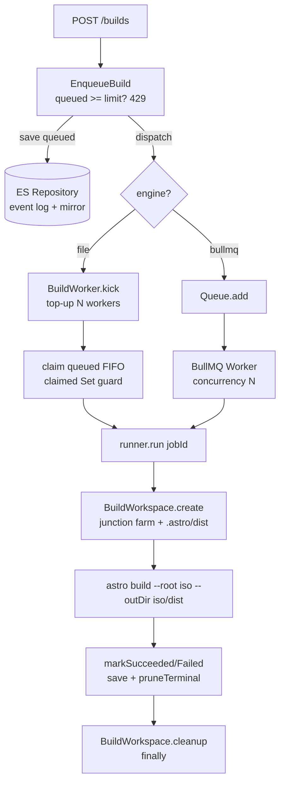
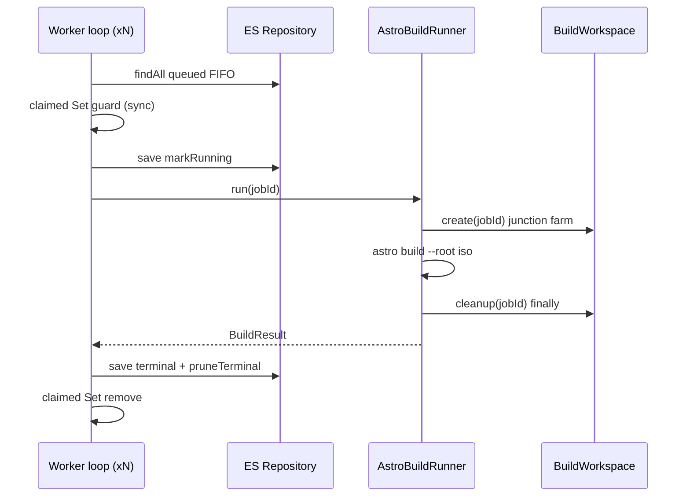

# concurrency-N Design Spec

**Tarih:** 2026-11-25
**Durum:** Onaylı tasarım (konsolide final onay)
**Roadmap:** Group F (done) → Faz-3 EventStore (merged PR #3) → **concurrency-N** → Faz-2+ OAuth
**Kapsam:** Yalnız build engine concurrency-N + per-build output isolation. Site association / artifact serving / CQRS / readiness / throttler kapsam-dışı.

---

## §1 Kararlar & sektör normu hizalaması

| Karar | Seçim | Norm gerekçesi |
|---|---|---|
| Birincil hedef | Gerçek N paralel astro build (output isolation şart) | Production-doğru concurrency; sahte knob değil |
| Build kimliği | Repo-wide build, per-jobId isolation (siteId YOK) | Mevcut model korunur; site association Faz-2+ territory, YAGNI |
| Isolation mekanizması | **A) Per-build izole root (symlink/junction farm)** | CI/build sistemleri job başına ayrı working directory kullanır (norm). Tek-host lightweight karşılığı. Content collection'lı repo'da dist + .astro tam isolation |
| Concurrency config | `ASTROPRESS_BUILD_CONCURRENCY`, default 1 | Mevcut davranış (serial) korunur; opt-in N |
| Recovery | Fail-only (interrupted running → failed, re-run YOK) | Faz-3 parity korunur |

**Reddedilen alternatifler:**
- **B) Sadece `--outDir`:** Astro 7.4.7'de `.astro/` cache `config.root`'a sabit (`settings.js:16`, `cacheDir` config/flag yok). Repo content collection kullanıyor (`src/content/blog|pages|products`) → eşzamanlı build'ler `.astro` content-layer cache'inde yarışır → correctness riski. Reddedildi.
- **C) Full working copy / git worktree:** Tam isolation ama node_modules kopyası ağır disk/zaman + karmaşık teardown. Maksimal form YAGNI ertelendi.

**Ortogonal pattern'ler ayrık:** concurrency-N ≠ CQRS (read/write model ayrımı gerekmez). ES (Faz-3) event log tek kaynak olarak kalır; concurrency yalnız worker processing modelini değiştirir.

---

## §2 Mimari & bileşenler

**Port değişikliği (tek arayüz kırılması):** `BuildRunner.run()` → `run(jobId: string)`. Application layer job kimliğini geçirir; isolation infrastructure detayı runner adapter'ında. `FakeBuildRunner.run(jobId)` record eder.

**Yeni bileşen — `BuildWorkspace` (infrastructure):** per-build izole root lifecycle.
- `workspaceDir` resolution: `ASTROPRESS_STATE/build-workspaces` (varsa) yoksa repo kökü `.astropress/build-workspaces` (`defaultEventsDir` emsali).
- `create(jobId)`: `<workspaceDir>/<jobId>/` altında gerçek root'tan junction/symlink (`src`, `public`, `astro.config.mjs`, `package.json`, `tsconfig.json`, `node_modules` — yalnız **var olan** entry'ler, olmayan atlanır); `.astro/` + `dist/` gerçek per-build dir.
- `cleanup(jobId)`: farm'ı sil (ephemeral output; artifact serving kapsam-dışı).
- `cleanupAll()`: boot'ta leftover farm'ları sil (crash kalıntısı).
- Cross-platform: win32 `fs.symlinkSync(target, path, 'junction')` (admin gerektirmez), POSIX `'dir'` symlink.

**Concurrency config:** `BUILD_CONCURRENCY` symbol token; `Number(ASTROPRESS_BUILD_CONCURRENCY) || 1` (invalid/0/negatif → 1). Her iki engine aynı token (parity). Hard upper cap YOK (operatör sorumluluğu).

**File engine pool:** serial FIFO loop → N-worker pool. In-memory `claimed Set<jobId>` çift-claim önler (single-process). Her worker loop: claim next queued (FIFO, not claimed) → markRunning → `runner.run(jobId)` → terminal → prune → repeat. `kick()` active worker sayısını N'e tamamlar (single-flight drain korunur).

**BullMQ engine:** `concurrency: N` (Redis job-lock native claim; in-memory Set gerekmez).

**Değişen dosyalar:**
- `application/ports.ts` — `BuildRunner.run(jobId)`, `BUILD_CONCURRENCY` token.
- `infrastructure/build-workspace.ts` — YENİ (create/cleanup/cleanupAll, junction farm).
- `infrastructure/astro-build-runner.ts` — farm + `--root`/`--outDir`, cleanup finally.
- `application/build-worker.ts` — N-pool + claimed Set.
- `infrastructure/bullmq/bullmq-build-worker.ts` — `concurrency: N`.
- `builds.module.ts` — `BUILD_CONCURRENCY` provider, `BuildWorkspace` wiring.
- Application use-case'leri (EnqueueBuild/Get/List) **DEĞİŞMEZ**.

---

## §3 Data flow & recovery

**Normal akış (file, N=2):**
1. POST → EnqueueBuild: queued depth >= limit → 429; else `save(queued)` → dispatch → kick.
2. kick active worker'ları N'e tamamlar. Worker loop: findAll → FIFO queued, claimed Set'te olmayan ilk job → Set'e ekle (senkron) → markRunning + save → `runner.run(jobId)`.
3. AstroBuildRunner.run(jobId): `BuildWorkspace.create` → `astro build --root <iso> --outDir <iso>/dist` → BuildResult resolve (throw YOK) → **finally** cleanup.
4. Worker: markSucceeded/Failed + save → pruneTerminal(retention) → Set'ten çıkar → loop.
5. drain single-flight: tüm worker bitince drainPromise null; yeni POST → kick top-up.

**BullMQ:** Queue.add → Worker concurrency N (Redis native distinct claim). Processor: findById → guard → markRunning → run(jobId) → terminal → prune.

**Claim yarışı (file, single-process):** claimed Set claim'den ÖNCE senkron kontrol + ekleme (arada await yok) → iki loop aynı job'ı seçemez. ES save idempotent (running→running no-op) ama Set çift `runner.run()`'ı önler (kritik olan).

**Recovery (boot, parity):**
- Crash running job'lar (N tane) → hepsi `failed (interrupted)`, re-run YOK.
- queued: file → kick top-up N resume; bullmq → orphan reconcile (Redis job yoksa dispatch-lost).
- Stale workspace dirs → boot `cleanupAll()` (event log/mirror'a dokunmaz).
- Processor running-guard idempotent.

---

## §4 Error handling & parity bounds

**Concurrency config:** `Number(env) || 1`; invalid/0/negatif → 1. Hard cap YOK (YAGNI).

**Isolation failure:** `BuildWorkspace.create` throw → runner yakalar → `BuildResult{ok:false, exitCode:-1, error}` (run asla throw etmez). cleanup **finally** (failure path'te de).

**Build failure/timeout:** mevcut `killTree` + 180s timeout parity; N child bağımsız timeout/tree. Timeout ilgili child tree'yi öldürür, diğerleri etkilenmez.

**Cleanup failure:** best-effort warn, BuildResult etkilenmez.

**Parity bounds (DEĞİŞMEZ):**
| Kural | Davranış |
|---|---|
| Queue-bound (D2) | `queued >= limit` → 429; running sayılmaz |
| Retention (D2) | pruneTerminal keep-last-N terminal; queued/running korunur; event log immutable |
| Recover | fail-only interrupted, re-run YOK |
| Boot-safe | cleanupAll best-effort brick YOK; Redis-down bullmq boot-safe |
| HTTP contract | POST 201, GET missing 404, list — değişmez |

**claimed Set leak guard:** worker exception → finally Set'ten çıkar. Process crash → Set in-memory uçar, boot recover running interrupted (tutarlı).

**Junction cross-device fail:** create throw → BuildResult failed (fallback copy YAGNI).

---

## §5 Testing & bracket

**Yeni testler:**
- `build-workspace.spec`: create junction farm doğrula (link'ler + gerçek .astro/dist), cleanup siler, cleanupAll leftover, win32 junction type. Temp dir izolasyonu.
- `astro-build-runner.spec` (genişler): run(jobId) spawn arg `--root`/`--outDir` (mock spawn), success+failure cleanup finally, isolation hatası → BuildResult failed (throw yok).
- `build-worker.spec` (genişler): N=2 + BlockingBuildRunner → 2 eşzamanlı running; claimed Set çift-claim önler (runner.calls === distinct); FIFO; single-flight; recover N interrupted; queue-bound/retention parity; N=1 regresyon.
- `bullmq-builds.spec` (genişler): concurrency N → N eşzamanlı (BlockingBuildRunner); parity guard.
- Config: BUILD_CONCURRENCY default 1, invalid → 1, env override.

**Regression bracket:** `BuildRunner.run(jobId)` → `FakeBuildRunner.run(jobId)` ripple (assertion korunur). Mevcut application testleri davranış değişmeden yeşil. Full backend + root build/test/smoke + smoke:http. CI [22,24].

---

## §6 Scope exclusions (YAGNI)

- Per-site build (siteId) — Faz-2+.
- dist artifact serving / output retention — ephemeral cleanup.
- CQRS, readiness, throttler — ayrı fazlar.
- Multi-host distributed concurrency.
- Hard concurrency cap.
- node_modules/.vite cache isolation (read-only paylaşım, production build'de önemsiz).
- Junction fallback copy.

---

## §7 Kabul kriterleri

1. `BUILD_CONCURRENCY` default 1; N>1 → N job eşzamanlı (file + bullmq parity).
2. Per-build izole root: dist + .astro per-jobId; eşzamanlı real build'ler yarışmadan succeeded.
3. claimed Set çift-processing önler (`runner.calls === distinct jobs`).
4. `run` asla throw etmez; isolation hatası → BuildResult failed; cleanup finally (success+failure).
5. Queue-bound/retention/recover/HTTP parity korunur (mevcut testler yeşil).
6. Boot `cleanupAll` leftover farm siler, boot-safe (brick yok).
7. CI [22,24] yeşil; regression bracket application davranışı değişmez.