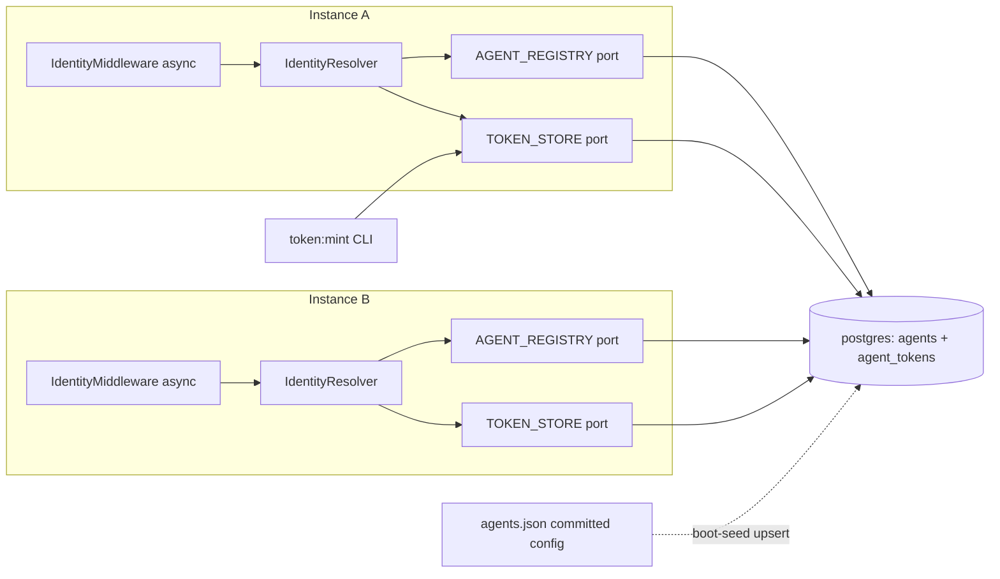

# Distributed Registry (Faz-4) — Design Spec

**Tarih:** 2026-11-25
**Durum:** Onaylı tasarım (konsolide final onay, 2026-11-25)
**Önceki fazlar:** Group F hardening ✔ (PR #1) · Faz-3 EventStore ✔ (PR #3) · concurrency-N ✔ (PR #4) · Faz-2+ token auth ✔ (PR #5)

## §1. Kararlar ve sektör normu

| Karar | Seçim | Sektör normu / gerekçe | Reddedilen alternatif |
|---|---|---|---|
| Kapsam | Agent registry + token store **birlikte** (user seçimi) | Multi-instance'ta token'lar shared ama agent tanımları instance-local kalırsa tutarsızlık; ikisi tek fazda | Sadece token store / sadece registry (yarım distributed senaryo) |
| Storage yaklaşımı | **Async port migration** + postgres adapter (Yaklaşım A) | Nest async repository deseni; DB doğal async, port'lar `Promise` taşır | B: sync facade + boot-cache → cross-instance freshness bozulur (mint A'da, B görmez); polling/LISTEN-NOTIFY karmaşıklığı |
| Env axis | **`ASTROPRESS_STORAGE=postgres` yeniden kullanılır** | Repo normu: tek storage axis (sites + builds ES aynı deseni kullanır); multi-instance deployment toptan shared storage ister | C: ayrı `ASTROPRESS_REGISTRY` knob → YAGNI config yüzeyi |
| Agent doğruluk kaynağı | **Boot-seed upsert**: agents.json (committed config) → postgres `init()`'te idempotent upsert (user seçimi) | Config-as-code / reference-data seeding (Laravel seeder emsali); tanımlar repo'da versiyonlanır, DB drift'i boot'ta düzelir | Seed-if-empty + DB authoritative → yeni yönetim CLI'ı gerekir (ek kapsam); agents config-only → distributed olmaz |
| Token doğruluk kaynağı | **Postgres authoritative** (runtime veri, seed YOK) | Mint edilen token runtime secret state; config değil | Token seed → plaintext/hash config'e sızmaz, rotate semantics bozulur |
| Registry port | **`AGENT_REGISTRY` symbol + interface extraction** | Faz-2+ self-review borcu: "MintToken application AgentRegistry concrete inject eder (registry port'u yok)" — bu fazda kapatılır | Concrete class inject devamı → postgres adapter DI ile bağlanamaz |
| Hash lookup (postgres) | `WHERE token_hash = $1` + UNIQUE index | High-entropy sha256 hash'te index lookup standart API-key deseni; timing attack DB index'te pratik değil | DB-side timing-safe karşılaştırma → gereksiz; file adapter'daki `timingSafeEqual` korunur |
| Pool sahipliği | Adapter başına own `Pool` | PostgresSiteRepository / PostgresEventStore emsali | Shared pool provider → modüller arası lifecycle coupling (repo deseni değil) |

## §2. Mimari

### §2.1 Port migration (async — internal breaking, HTTP yüzeyi değişmez)

**Yeni port** `backend/src/security/application/agent-registry.ts`:

```ts
import { Agent } from '../domain/agent';

export const AGENT_REGISTRY = Symbol('AGENT_REGISTRY');

export interface AgentRegistry {
  getAgent(id: string): Promise<Agent>;   // unknown → UnknownAgentError (reject)
  listAgents(): Promise<Agent[]>;
}
```

**Mevcut concrete class taşınır:** `infrastructure/agent-registry.ts` → `infrastructure/file-agent-registry.ts`, class adı `FileAgentRegistry implements AgentRegistry`. `AGENTS_FILE` symbol + `defaultAgentsFile()` yeni dosyaya taşınır (export adları değişmez). Constructor'da dosyayı bir kez okuma davranışı **korunur** (file-mode parity: config boot'ta yüklenir); metodlar async imza, sync iç işleyiş.

**`TokenStore` port imzaları** (`application/token-store.ts`, `hashToken` değişmez):

```ts
export interface TokenStore {
  findAgentByHash(hash: string): Promise<string | null>;
  setHash(agentId: string, hash: string): Promise<void>;
}
```

`FileTokenStore` async imza, sync iç işleyiş (per-call read, `timingSafeEqual` + length guard, atomic tmp+rename — hepsi korunur).

**`IdentityResolver` port** (`application/identity-resolver.ts`):

```ts
export interface IdentityResolver {
  resolve(req: AgentRequest): Promise<Agent>;
}
```

- `HeaderIdentityResolver` / `TokenIdentityResolver`: `async resolve`, `await this.registry.getAgent(...)` / `await this.store.findAgentByHash(...)`. Hata eşlemeleri birebir korunur (header yok → default `content-studio`; `UnknownAgentError` → `UnauthorizedException`; bearer regex `/^Bearer (.+)$/i`; fail-closed, fallback YOK).
- `IdentityMiddleware`: `async use(req, res, next)` → `req.agent = await this.resolver.resolve(req); next();`. Nest async middleware destekler; reject → ExceptionsHandler 401 (mevcut sync throw yoluyla aynı).
- `PermissionGuard` / `AgentThrottlerGuard` / `HostMiddleware`: **değişmez** (`req.agent` okurlar).

**`MintToken`** (`application/mint-token.ts`): `async execute(agentId): Promise<string>` — `await this.registry.getAgent(agentId)` (validate), token üretimi (`astro_` + base64url(32 byte)) değişmez, `await this.store.setHash(...)`. Constructor `AgentRegistry` **port** inject eder (concrete değil — Faz-2+ borcu kapanır).

### §2.2 Postgres adapter'lar

Emsal: `PostgresSiteRepository` (own Pool, `init()`, `close()`, `OnModuleDestroy`, constructor'da boş URL → boot error).

**`PostgresAgentRegistry`** (`infrastructure/postgres-agent-registry.ts`):

```ts
constructor(url: string, agentsFile: string)
// url boş → throw Error('DATABASE_URL tanımlı değil (ASTROPRESS_STORAGE=postgres)')
// agentsFile: seed kaynağı (agents.json formatı: {id: {name, perms}})
async init(): Promise<void>  // CREATE TABLE IF NOT EXISTS + seed upsert
async getAgent(id): Promise<Agent>      // SELECT per-request; yok → UnknownAgentError
async listAgents(): Promise<Agent[]>    // SELECT tümü
async close(): Promise<void>            // pool.end(); onModuleDestroy → void close()
```

Şema:

```sql
CREATE TABLE IF NOT EXISTS agents (
  id TEXT PRIMARY KEY,
  name TEXT NOT NULL,
  perms TEXT NOT NULL          -- JSON (sites.locales TEXT-JSON emsali)
)
```

Seed: `init()` agents.json'ı okur, her agent için `INSERT ... ON CONFLICT (id) DO UPDATE SET name = EXCLUDED.name, perms = EXCLUDED.perms` — **idempotent upsert**. Multi-instance eşzamanlı boot ON CONFLICT-safe. Config'den silinen agent DB'de kalır (delete semantics YAGNI — §6).

**`PostgresTokenStore`** (`infrastructure/postgres-token-store.ts`):

```ts
constructor(url: string)   // boş url → aynı boot error
async init(): Promise<void>
async findAgentByHash(hash): Promise<string | null>  // SELECT agent_id WHERE token_hash = $1
async setHash(agentId, hash): Promise<void>          // upsert ON CONFLICT (agent_id) — rotate=replace parity
async close(): Promise<void>
```

Şema:

```sql
CREATE TABLE IF NOT EXISTS agent_tokens (
  agent_id TEXT PRIMARY KEY,
  token_hash TEXT NOT NULL UNIQUE
)
```

Token başına tek agent (agent_id PK) = Faz-2+ rotate=replace semantics birebir. UNIQUE token_hash: aynı hash iki agent'a yazılamaz (pratikte çarpışma imkânsız, bütünlük garantisi).

### §2.3 Wiring (SecurityModule)

`DATABASE_URL` symbol'ü `sites/infrastructure/postgres-site.repository`'den import edilir (builds.module emsali); SecurityModule kendi factory'sini provide eder.

```ts
{ provide: AGENTS_FILE, useFactory: () => defaultAgentsFile() },
{ provide: TOKEN_STORE_FILE, useFactory: () => defaultTokenStoreFile() },
{ provide: DATABASE_URL, useFactory: () => process.env.DATABASE_URL || '' },
{
  provide: AGENT_REGISTRY,
  useFactory: async (agentsFile: string, url: string): Promise<AgentRegistry> => {
    if (process.env.ASTROPRESS_STORAGE === 'postgres') {
      const registry = new PostgresAgentRegistry(url, agentsFile);
      await registry.init();   // CREATE + boot-seed upsert
      return registry;
    }
    return new FileAgentRegistry(agentsFile);
  },
  inject: [AGENTS_FILE, DATABASE_URL],
},
{
  provide: TOKEN_STORE,
  useFactory: async (file: string, url: string): Promise<TokenStore> => {
    if (process.env.ASTROPRESS_STORAGE === 'postgres') {
      const store = new PostgresTokenStore(url);
      await store.init();
      return store;
    }
    return new FileTokenStore(file);
  },
  inject: [TOKEN_STORE_FILE, DATABASE_URL],
},
// IDENTITY_RESOLVER factory: inject [AGENT_REGISTRY, TOKEN_STORE] — ASTROPRESS_AUTH axis aynen kalır
```

`ASTROPRESS_STORAGE` × `ASTROPRESS_AUTH` **ortogonal axis'ler**: storage (file|postgres) × auth (header|token) dört kombinasyon da geçerli; postgres+header ve file+token dahil.

### §2.4 Diyagram



## §3. Data flow

**Token-mode istek (postgres):** Bearer header → `hashToken` (sha256 hex) → `PostgresTokenStore.findAgentByHash` (index lookup) → `agent_id` → `PostgresAgentRegistry.getAgent` (per-request SELECT) → `req.agent` → RBAC/throttler (değişmez).

**Mint (postgres):** `token:mint <agentId>` CLI → `ASTROPRESS_STORAGE=postgres` ise `PostgresAgentRegistry(url, agentsFile)` + `PostgresTokenStore(url)` kurar, `await init()` (registry seed dahil), `MintToken.execute` → plaintext bir kez stdout, `finally` close. File modunda mevcut davranış birebir. Bridge CLI emsali: construction sonrası init await, hata → exit 1.

**Boot-seed:** her instance boot'unda agents.json → upsert. İki instance farklı config sürümüyle boot ederse son boot eden kazanır (config-as-code: dağıtım aynı commit'ten yapılır varsayımı; drift düzeltme boot'ta).

**Freshness garantisi:** postgres okumaları per-request query, cache yok → A'da mint edilen token B'de bir sonraki istekte geçerli. File modunda freshness zaten per-call read (FileTokenStore) / boot-load (FileAgentRegistry, parity).

## §4. Hata yönetimi ve parity

| Durum | Davranış |
|---|---|
| Default (axis unset/file) | Mevcut davranış birebir; 248 test yeşil (yalnız await adaptasyonu) |
| `ASTROPRESS_STORAGE=postgres` + `DATABASE_URL` boş | Boot error (constructor throw — sites emsali) |
| Postgres'e ulaşılamıyor (boot) | `init()` reject → boot fail-fast (sessiz fallback YOK) |
| Bilinmeyen agent (her iki mod) | `UnknownAgentError` → resolver `UnauthorizedException` 401 |
| Boş token tablosu / dosyası | Boot-safe; token-mode istekler 401 (crash değil) |
| Geçersiz/eksik bearer | 401, fallback YOK (Faz-2+ parity) |
| RBAC / throttler / Host / 1MB body | **Değişmez** — identity-only swap |
| MCP `auth.mjs` | Değişmez (header/file — backend-only faz) |

## §5. Testing

- **File adapter parity:** mevcut `agent-registry.spec.ts` → `file-agent-registry.spec.ts` (async adaptasyon, davranış assertion'ları değişmez); `file-token-store.spec.ts`, `header-identity.resolver.spec.ts`, `token-identity.resolver.spec.ts`, `mint-token.spec.ts` await adaptasyonu. `StubTokenStore` async imza.
- **Postgres adapter spec'leri:** `postgres-agent-registry.spec.ts`, `postgres-token-store.spec.ts` — `skip` (DATABASE_URL unset) + `SkipTest` (sunucuya ulaşılamıyor) deseni, `TRUNCATE agents, agent_tokens` izolasyonu (freshRepo emsali). Kalıcılık (close+reopen), upsert rotate, seed idempotency, seed drift-düzeltme (DB'de bozuk name → init → config değeri).
- **Multi-instance testi:** aynı DB'de iki ayrı `PostgresTokenStore` + `PostgresAgentRegistry` instance'ı → A'da `setHash` → B'de `findAgentByHash` anında görür; A'da seed → B'de `getAgent` görür.
- **Perimeter postgres:** `perimeter.http.postgres.spec.ts` (sites.http.postgres emsali) — token-mode + postgres boot: valid bearer 201, invalid 401, RBAC 403, boot-seed sonrası agent'lar mevcut. Skip-gating aynı.
- **CLI smoke:** file modu mevcut davranış; postgres modu mint → stdout token + DB'de hash doğrulama (test veya manuel smoke).
- **Full bracket:** backend tüm suite + root 30/30 + 12 sayfa + smoke + smoke:http. CI [22,24] postgres+redis servisleriyle postgres testleri koşar.

## §6. YAGNI excluded

- Agent yönetim CLI'ı/endpoint'i (ekleme/silme DB üzerinden) — seed config'den, config-as-code.
- Config'den silinen agent'ın DB'den silinmesi (delete semantics) — upsert-only seed.
- Cache + LISTEN/NOTIFY invalidation — per-request query yeterli (okuma yükü gerekirse sonraki faz).
- Ayrı `ASTROPRESS_REGISTRY` axis; sqlite/memory registry adapter'ları.
- MCP token auth; OAuth2 client-credentials (aynı `IdentityResolver` seam'ine ileride adapter olarak katmanlanabilir).
- Shared pool provider; migration framework'ü (CREATE TABLE IF NOT EXISTS emsal yeterli).

## §7. Acceptance criteria

1. `AGENT_REGISTRY` port + `FileAgentRegistry`/`PostgresAgentRegistry` adapter'ları; `TokenStore` async port + `FileTokenStore`/`PostgresTokenStore` adapter'ları mevcut.
2. Default file modunda tüm mevcut testler (async adaptasyon sonrası) yeşil — davranış parity'si kanıtlı.
3. `ASTROPRESS_STORAGE=postgres` + `DATABASE_URL` ile boot: agents.json seed edilir (idempotent), token mint/verify postgres üzerinden çalışır.
4. Multi-instance testi: A'da mint → B'de verify anında geçerli.
5. `token:mint` CLI her iki storage modunda çalışır; postgres modunda init/close yapılır.
6. Hata tablosu (§4) testlerle kanıtlı: boot error, fail-fast, 401 yolları, boot-safe boş store.
7. Full bracket yeşil: backend suite + root 30/30 + smoke + smoke:http; CI [22,24] yeşil.
8. README env dokümanı güncel (kök README — backend/README.md yok): `ASTROPRESS_STORAGE=postgres` artık agents+tokens'ı da kapsar.

## Ölçeklenebilirlik fazları

1. **Bu faz:** shared postgres, per-request query, boot-seed config.
2. **Sonraki (koşullu):** okuma yükü gerekirse cache + LISTEN/NOTIFY invalidation; agent yönetim yüzeyi gerekirse admin CLI.
3. **Sonraki (koşullu):** OAuth2 client-credentials → `IdentityResolver` seam'ine yeni adapter (static key parity korunur).

## Self-review notu

- Placeholder yok; tüm imza/şema/wiring somut.
- Async migration'ın dalga boyu net: port'lar → resolver'lar → middleware → MintToken → CLI → test adaptasyonu; guard'lar ve HTTP yüzeyi değişmez.
- Kapsam tek planlık: port migration + 2 adapter + wiring + CLI + README.