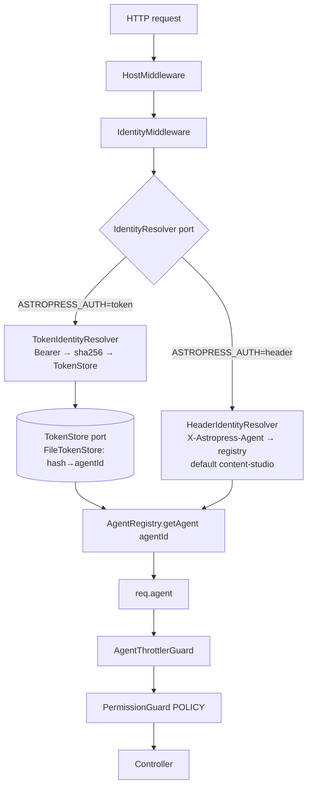

# Faz-2+ Token Auth — Design Spec

**Tarih:** 2026-11-25
**Branch:** `feat/faz2-token-auth`
**Durum:** onaylı tasarım (konsolide final onay), writing-plans bekliyor
**Önceki fazlar:** Group F (PR #1) + Faz-3 EventStore (PR #3) + concurrency-N (PR #4) merged.

## §1 Kararlar + sektör normu

| # | Karar | Seçim | Sektör normu / gerekçe |
|---|---|---|---|
| 1 | Kapsam | Token auth **tek faz**; distributed registry sonraki faza ertelendi | foundation-first; iki bağımsız subsystem ayrı spec/plan döngüsü |
| 2 | Credential modeli | **Statik API key (bearer)** | M2M internal service normu (GitHub API token, Laravel Sanctum). İstemciler internal agent + operator; üçüncü-parti uygulama değil → OAuth2 authorization-code YAGNI |
| 3 | Migration | **Opt-in axis** `ASTROPRESS_AUTH=header\|token`, default `header` | repo'nun engine/storage axis deseni (`ASTROPRESS_BUILDS`, `ASTROPRESS_STORAGE`); mevcut parity + 217 test yeşil kalır |
| 4 | Hash | **SHA-256** hex + timing-safe compare | high-entropy random key (parola değil) → fast hash normu (GitHub/Sanctum). argon2/bcrypt parola içindir, gereksiz maliyet |
| 5 | Secret store | Gitignore'lu `.astropress/agent-tokens.json` (yalnız hash) | secret asla committed değil; `agents.json` committed config (perms/name) kalır |
| 6 | Kimlik seam | `IdentityResolver` port + 2 adapter (header/token) | ports/adapters clean architecture; `BuildDispatcher` engine-seam emsali |
| 7 | MCP kapsamı | **Backend-only**; MCP `auth.mjs` header kalır | strangler deseni; MCP ayrı yüzey, bu fazın kapsamı dışında |

**Reddedilen alternatifler:**
- OAuth2 client-credentials / JWT bearer → daha fazla hareketli parça (issuance/expiry/signing/revocation); static key M2M için yeterli, YAGNI.
- Tam replacement (token default) → breaking change, loopback-trusted model biter, mevcut header testleri/client'lar güncellenmeli. Opt-in parity korur.
- Middleware içi branch (port'suz) → daha sade ama seam'i gizler, adapter'ları bağımsız test edilemez kılar. Port seçildi.

## §2 Mimari

Mevcut `IdentityMiddleware` kimlik çözümünü bir **porta** devreder; `SecurityModule` `ASTROPRESS_AUTH`'a göre adapter seçer. RBAC/throttler/host/body **değişmez** — hepsi `req.agent` okur (identity layer swap, perimeter parity).

### Yeni bileşenler (`backend/src/security/`)

| Dosya | Sorumluluk |
|---|---|
| `application/identity-resolver.ts` | `IdentityResolver` port: `resolve(req: AgentRequest): Agent` (kimlik yoksa `UnauthorizedException` fırlatır) + `IDENTITY_RESOLVER` symbol |
| `application/token-store.ts` | `TokenStore` port: `findAgentByHash(hash: string): string \| null` + `TOKEN_STORE` symbol |
| `infrastructure/header-identity.resolver.ts` | Mevcut header davranışı: `X-Astropress-Agent` → `AgentRegistry`, default `content-studio`, unknown → 401 (parity) |
| `infrastructure/token-identity.resolver.ts` | `Authorization: Bearer` → sha256 → `TokenStore.findAgentByHash` → `AgentRegistry.getAgent`; eksik/geçersiz → 401, fallback YOK |
| `infrastructure/file-token-store.ts` | Gitignore'lu JSON `{ agentId: sha256hex }`; atomic write (tmp+rename); timing-safe compare; `TOKEN_STORE_FILE` symbol + `defaultTokenStoreFile()` |
| `src/scripts/token-mint.ts` | CLI: token üret/rotate, hash store'a yaz, plaintext bir kez bas |

### Değişen mevcut dosyalar
- `interface/identity.middleware.ts` — `AgentRegistry` yerine `IDENTITY_RESOLVER` inject eder; `req.agent = resolver.resolve(req)`.
- `security.module.ts` — `ASTROPRESS_AUTH` factory: header/token resolver provider; `TOKEN_STORE` + `TOKEN_STORE_FILE` provider; `TokenStore`/`AgentRegistry` wiring.

## §3 Data flow + token minting

### header mode (default, parity)
Değişmez: `X-Astropress-Agent` header → `AgentRegistry.getAgent`, eksik header → `content-studio`, unknown → 401. Mevcut 217 test yeşil.

### token mode
1. `Authorization: Bearer astro_<base64url(32 byte)>` okunur.
2. Token `sha256` hex'e hash'lenir.
3. `TokenStore.findAgentByHash(hash)` → `agentId | null` (timing-safe compare).
4. `AgentRegistry.getAgent(agentId)` → `Agent` (perms) → `req.agent`.
5. Eksik bearer / geçersiz format / bilinmeyen hash / registry drift → **401 fail-closed**. Default fallback YOK.
6. `X-Astropress-Agent` token mode'da **ignore** edilir (kimlik yalnız bearer'dan).

### Token format
- Opaque high-entropy: `astro_` + `base64url(crypto.randomBytes(32))` (~43 char, 256-bit entropy).
- Store'da yalnız `sha256(token)` hex — plaintext asla saklanmaz.

### Mint CLI
- `npm --prefix backend run token:mint -- <agentId>` (compiled `dist/src/scripts/token-mint.js`).
- 256-bit random token üretir, `sha256` hash'i store'a **atomic** yazar (tmp+rename, repo convention), plaintext'i **bir kez** stdout basar.
- Re-mint = **rotate** (mevcut hash replace).
- `agentId` `AgentRegistry`'de yoksa → reject (non-zero exit).
- Store dosyası yoksa oluşturur (`.astropress/` gitignore'lu).

## §4 Error handling / parity / boot-safe

| Durum | Davranış |
|---|---|
| Token store yok/boş (token mode) | App **boot eder**; tüm istekler 401 (fail-closed, crash yok) |
| Eksik `Authorization` header | 401 |
| Geçersiz bearer format (`Bearer ` değil, boş token) | 401 |
| Bilinmeyen token hash | 401 |
| Hash → agentId ama registry'de yok (drift) | 401 |
| header mode | Mevcut davranış birebir (default content-studio, unknown 401) |

**Parity (iki modda identical):** RBAC fail-closed `POLICY`, per-agent throttler (GET exempt), Host allowlist, 1MB body limit. Identity layer dışında perimeter değişmez.

**Boot-safe:** token store okuma hatası boot'u brick etmez (sites API boot eder); store boş/yok → fail-closed 401. `AgentRegistry` committed `agents.json`'dan okunur (mevcut).

**MCP:** `auth.mjs` değişmez (header-based, backend-only faz).

## §5 Testing

| Test | Kapsam |
|---|---|
| `file-token-store.spec.ts` | hash lookup, bilinmeyen hash → null, timing-safe compare, atomic write, dosya yok → boş |
| `token-identity.resolver.spec.ts` | geçerli bearer → doğru agent; eksik/geçersiz/bilinmeyen → 401; fallback yok; `X-Astropress-Agent` ignore |
| `header-identity.resolver.spec.ts` | mevcut header davranışı regression (default content-studio, unknown 401) |
| `perimeter.http.spec.ts` (token-mode ek) | `ASTROPRESS_AUTH=token` + seed'li store boot: reader 403 / content-studio 201 (RBAC), missing/invalid bearer → 401, per-agent rate-limit, GET token ister |
| `token-mint.spec.ts` | token üretim + hash store, rotation (hash replace), bilinmeyen agent reject, plaintext stdout |
| Full bracket regression | header default → mevcut 217 test yeşil; root build/test/smoke |

**Test izolasyonu:** `ASTROPRESS_STATE` temp'e yönlendirir (store + agents); `ASTROPRESS_AUTH` afterEach restore. Token-mode boot seed'li store kullanır (mint edilmiş hash).

## §6 Scope-dışı (YAGNI)

- **Distributed registry** (postgres/shared agent+token store, multi-instance) → sonraki faz.
- OAuth2 token endpoint / expiry / refresh / rotation UI.
- JWT signing / self-contained token.
- MCP token parity (backend-only).
- Token admin HTTP endpoint (CLI mint yeterli).
- Slow hash (bcrypt/argon2) — high-entropy key için sha256 norm.
- Token scope/permission granularity (mevcut 5-perm RBAC korunur).

## §7 Kabul kriterleri

1. `ASTROPRESS_AUTH` default `header` → mevcut parity yeşil (217 test değişmez).
2. token mode: geçerli bearer → doğru agent + RBAC; eksik/geçersiz/bilinmeyen → 401 fail-closed (fallback yok).
3. Store gitignore'lu, yalnız sha256 hash, timing-safe compare; plaintext saklanmaz.
4. Mint CLI token üretir/rotate eder; bilinmeyen agent reddedilir; plaintext bir kez basılır.
5. RBAC/throttler/host/body iki modda değişmez.
6. Boot-safe: store yok/boş → crash yok, fail-closed 401.
7. CI [22,24] yeşil; MCP `auth.mjs` değişmez.

## Ölçeklenebilirlik fazları (future seams)

- **Sonraki faz (distributed registry):** `TokenStore` + `AgentRegistry` portları adapter-seam'li → postgres/shared adapter application değişmeden eklenir (multi-instance). Token store ve agent registry aynı shared backend'e taşınır.
- **İleride (dış istemci):** OAuth2 client-credentials aynı `IdentityResolver` seam'ine yeni adapter olarak katmanlanır; static key parity korunur.

## Self-review notları

- **Placeholder scan:** TBD/TODO yok; tüm bileşenler somut dosya + imza ile tanımlı.
- **Internal consistency:** §2 mimari §3 data flow + §4 error ile tutarlı; identity-only swap, perimeter parity korunur.
- **Scope check:** tek subsystem (token auth), tek implementation plan'a uygun; distributed registry ayrı faz.
- **Ambiguity check:** token mode'da fallback yok (net fail-closed); hash sha256 hex (net); store format `{ agentId: hash }` (net); mint rotation = replace (net).