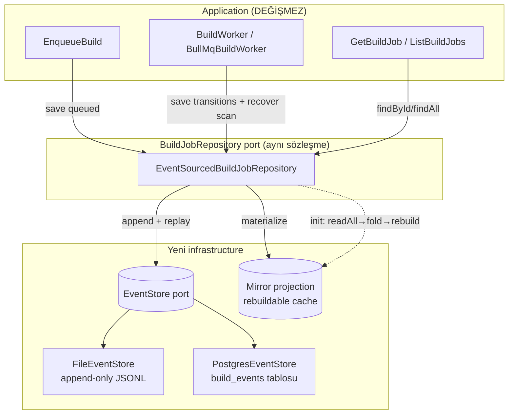
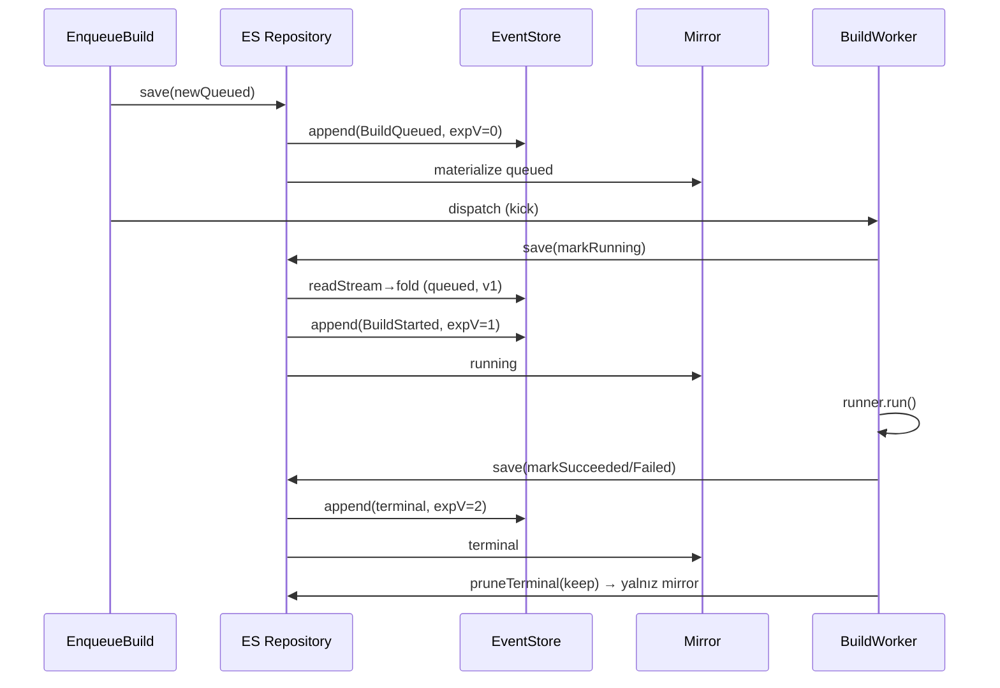

# Faz-3 EventStore — Design Spec

**Tarih:** 2026-11-25
**Faz:** P2.4 roadmap → Group F (COMPLETE) → **Faz-3 EventStore**
**Kapsam:** Yalnız EventStore (event-sourced build persistence + full recovery). Readiness promise, throttler atomicity, concurrency-N, CQRS-full bu fazda YOK (ayrı fazlar).
**Kaynak seam:** `2026-11-24-f-hardening-backlog-design.md` §8 (Faz-3 EventStore: event-sourced tam recovery).

## 1. Amaç & kararlar

Build job state'i şu an **state-based**: `BuildJob` aggregate file mirror'a (`builds.json`) yazılır, boot'ta stale running→failed(interrupted), dispatch'siz queued→failed(dispatch-lost) taranır. Faz-3 bunu **true event-sourcing**'e çevirir: append-only event log tek kaynak, mirror türetilmiş rebuildable projection, recovery replay'den.

| # | Karar | Seçim | Gerekçe |
|---|-------|-------|---------|
| 1 | Event-sourcing derinliği | **True ES** (event log tek kaynak, mirror projection) | Sektör normu; full recovery + audit + replay |
| 2 | Kalıcılık | **File + Postgres parity** adapter | Mevcut ports/adapters deseni; file infra'sız default, postgres opt-in durable |
| 3 | Recovery politikası | **Fail-only** (parity koru) | Interrupted running → failed, auto re-run YOK; idempotent, dist yarışı yok |
| 4 | Entegrasyon | **Yaklaşım A** — EventStore portu repository adapter'ının altında | Application + parity testleri DEĞİŞMEZ; düşük blast radius; framework'ların standart kalıbı |
| 5 | Kapsam sınırı | **Sadece EventStore** | Tek odaklı spec; readiness/throttler/concurrency-N ayrı faz |

### 1.1 Sektör normu hizalaması

Event sourcing'in kanonik invariant'ları (Fowler, Greg Young; EventStoreDB/Marten/Axon kalıbı):

1. Event = tek kaynak (append-only, immutable, silinmez)
2. Aggregate replay ile kurulur (snapshot+replay opsiyonel)
3. Optimistic concurrency (append'de expected stream version, conflict → reject)
4. Projection türetilmiş + rebuildable
5. Repository arayüzü event log'u gizler (load = replay, save = append)

**CQRS ayrı bir eksen, ES'in parçası değil** (ortogonal). CQRS-full (ayrı command/query modeli + ayrı read DB) ancak read/write workload'ları bağımsız ölçeklenince eklenir → bu kapsam için YAGNI. concurrency-N fazında gerekirse CQRS-lite değerlendirilir (tohum: expectedVersion append).

## 2. Mimari & bileşenler



### 2.1 Domain event'ler (`builds/domain/build-event.ts`)

Her event: `{ type, streamId, version, ts, payload }`. `streamId` = build job id. `version` stream başına monotonik, 1'den başlar. `ts` = event append zamanı (ISO).

| Event | Payload | Transition |
|-------|---------|------------|
| `BuildQueued` | `{ createdAt }` | (yok) → queued |
| `BuildStarted` | `{ startedAt }` | queued → running |
| `BuildSucceeded` | `{ finishedAt, exitCode, logTail }` | running → succeeded |
| `BuildFailed` | `{ finishedAt, error, exitCode?, logTail? }` | running → failed |
| `DispatchLost` | `{ finishedAt }` | queued → failed (error='dispatch-lost') |

Event'ler immutable value object; `BuildEvent` discriminated union (type tag). Fold yasadışı geçişte `BuildValidationError` fırlatır (domain guard reuse).

### 2.2 EventStore portu (`builds/application/ports.ts`)

```ts
export const EVENT_STORE = Symbol('EVENT_STORE');

export interface EventStore {
  // Optimistic concurrency: actual stream version !== expectedVersion → ConcurrencyError.
  // expectedVersion = stream'deki mevcut event sayısı (yeni stream = 0). Batch atomik append.
  append(streamId: string, events: BuildEvent[], expectedVersion: number): Promise<void>;
  readStream(streamId: string): Promise<BuildEvent[]>;   // version sıralı
  readAll(): Promise<BuildEvent[]>;                       // recovery rebuild için tüm stream'ler
}
```

### 2.3 Adapter'lar (parity)

**FileEventStore** (`infrastructure/file-event-store.ts`):
- Append-only JSONL: stream başına `<state>/build-events/<streamId>.jsonl` (her satır bir event JSON).
- Senkron read/write (run-to-completion → file mode single-flight parity, lost-wakeup yok).
- `append`: son version'ı oku, `expectedVersion` mismatch → `ConcurrencyError`; değilse satır append.
- Atomic: tmp + rename (crash mid-write truncated dosya bırakmaz) — mevcut file repo deseni.
- Corrupt satır → quarantine + empty (boot-safe degrade).
- Konum: `ASTROPRESS_STATE` test izolasyonu (store.mjs convention), yoksa repo kökü `.astropress/build-events/`.

**PostgresEventStore** (`infrastructure/postgres-event-store.ts`):
- Tablo: `build_events(stream_id text, version int, type text, payload jsonb, ts timestamptz, PRIMARY KEY(stream_id, version))`.
- `append`: transactional batch INSERT; unique-violation (23505) → `ConcurrencyError`.
- `readStream`: `WHERE stream_id=$1 ORDER BY version`. `readAll`: `ORDER BY stream_id, version`.
- Şema init: `CREATE TABLE IF NOT EXISTS` (sites postgres adapter deseni).
- Boot-safe: bağlantı hatası → init catch → mirror empty, app boot eder.

### 2.4 EventSourcedBuildJobRepository (`infrastructure/event-sourced-build-job.repository.ts`)

`BuildJobRepository`'yi implement eder + `OnModuleInit`.

- **`onModuleInit`**: `readAll()` → stream'lere grupla → fold → mirror'ı sıfırdan rebuild. Mirror silinse/bozulsa bile event'lerden geri gelir (full recovery). Best-effort catch (brick yok).
- **`save(job)`**: stream'den mevcut state'i fold et (authoritative) → status diff'inden event türet (§3.2) → `expectedVersion`=event sayısı ile append → mirror güncelle. Aynı status → no-op (append yok).
- **`findById/findAll`**: mirror projection'dan oku.
- **`pruneTerminal(keep)`**: **yalnız mirror**'ı buda (keep-last-N terminal, queued/running korunur). Event log immutable, asla budanmaz.

### 2.5 Module wiring (`builds.module.ts`)

- `BUILD_JOB_REPOSITORY` → `EventSourcedBuildJobRepository` (eski `FileBuildJobRepository` emekli).
- `EVENT_STORE` token: `ASTROPRESS_STORAGE=postgres` → `PostgresEventStore`; **diğer tüm modlar** (file/memory/sqlite) → `FileEventStore`. Event store yalnız file+postgres adapter sunar; sqlite/memory sites modlarında event store file kalır (deliberate mapping, sqlite event adapter YAGNI). Engine ekseninden (`ASTROPRESS_BUILDS` file|bullmq) **orthogonal**.
- Mirror konumu: `BUILDS_FILE` (mevcut `.astropress/builds.json`) projection olarak korunur.
- NestJS init sırası: repo (dependency) → worker. Mirror, worker recover taramasından önce rebuild edilir.

## 3. Data flow

### 3.1 Normal build (file mode)



BullMQ mode: processor aynı `repo.save` zincirini kullanır (engine orthogonal).

### 3.2 save → event türetme (status diff)

| Eski → Yeni | Event |
|-------------|-------|
| (yok) → queued | BuildQueued |
| queued → running | BuildStarted |
| running → succeeded | BuildSucceeded |
| running → failed | BuildFailed |
| queued → failed | DispatchLost |
| aynı status | no-op |

Payload job props'tan (`startedAt/finishedAt/exitCode/logTail/error`). `expectedVersion` = stream'deki event sayısı; concurrent append → `ConcurrencyError`.

### 3.3 Fold/replay

`BuildJob` event dizisinden katlanır: `BuildQueued`→`newQueued`, `BuildStarted`→`markRunning`, `BuildSucceeded`→`markSucceeded`, `BuildFailed`→`markFailed`, `DispatchLost`→`markDispatchLost`. Yasadışı geçiş → `BuildValidationError`. Tek fold hem `save`'de mevcut state hem init'te mirror rebuild için (tek kaynak).

### 3.4 Full recovery (boot, application DEĞİŞMEZ)

1. `EventSourcedBuildJobRepository.onModuleInit`: `readAll()` → grupla → fold → **mirror rebuild**.
2. Mevcut `BuildWorker.recover()` / `BullMqBuildWorker` boot-recover taraması rebuild edilmiş mirror üzerinde: running→`save(markFailed 'interrupted')` → BuildFailed event append; bullmq dispatch'siz queued→`save(markDispatchLost)` → DispatchLost event append. **Fail-only, auto re-run YOK.**
3. Best-effort: repo/Redis hatası boot'u brick etmez.

### 3.5 Reads

`GetBuildJob/ListBuildJobs` → `findById/findAll` → mirror. Event'ler authoritative; mirror her an rebuild edilebilir.

## 4. Error handling

| Durum | Davranış |
|------|----------|
| `ConcurrencyError` (append version mismatch) | Reject; single-flight'ta beklenmez; boot compensation best-effort catch (brick yok) |
| Corrupt event log (file) | Quarantine + empty (file repo parity); slice functional, boot-safe degrade |
| Postgres down / repo init hatası | `onModuleInit` catch → mirror empty, app boot eder (sites parity) |
| Redis down (bullmq) | Mevcut boot-safe (worker error log, degrade) |
| `pruneTerminal` | Yalnız mirror; event log immutable, asla budanmaz |
| Transient IO (EBUSY/EPERM) | Propagate (quarantine ETME — state destroy edilmez), mevcut parity |

## 5. Testing (TDD, bracket)

| Katman | Test |
|--------|------|
| EventStore contract (file+pg parity) | append/readStream/readAll; optimistic conflict → ConcurrencyError; immutability; boş stream |
| Fold/replay unit | event dizisi → BuildJob; yasadışı geçiş → BuildValidationError; tüm event tipleri |
| ES Repository contract | mevcut BuildJobRepository parity suite **aynen geçer**; save→event mapping; **mirror-lost recovery** (mirror sil → init → findAll event'lerden döner) |
| Recovery | crash simülasyonu (running terminal-yok) → rebuild → compensating BuildFailed → failed; dispatch-lost; mirror corrupt → rebuild |
| Regression bracket | mevcut build-worker / bullmq processor / shutdown / sites parity testleri **DEĞİŞMEDEN geçer** |

**Parity strategy:** EventStore + ES Repository için file+postgres **aynı contract suite** (sites `*.contract` deseni). Postgres testleri CI'da `DATABASE_URL` ile (mevcut service). File mode infra'sız default.

## 6. Kapsam-dışı (bu fazda YOK)

- Readiness promise / healthz endpoint
- Throttler Lua atomicity yeniden değerlendirme
- CQRS-full (ayrı command/query modeli + read DB)
- Concurrency-N (multi-instance yatay ölçek) — tohum: expectedVersion append
- Auto re-run / retry (interrupted build)
- Event compaction / snapshot

Bunlar ayrı fazlar (F-spec §8 seam'leri).

## 7. Kabul kriterleri

1. EventStore port + file/postgres adapter, aynı contract suite yeşil (optimistic concurrency dahil).
2. EventSourcedBuildJobRepository mevcut BuildJobRepository parity suite'i değiştirilmeden geçer.
3. Mirror silinip init sonrası findAll event'lerden doğru state'i döndürür (full recovery kanıtı).
4. Crash simülasyonunda interrupted running → BuildFailed event append + failed; auto re-run yok.
5. Mevcut application (build-worker, bullmq processor, shutdown, sites) testleri DEĞİŞMEDEN yeşil (regression bracket).
6. `pruneTerminal` event log'u budamaz (immutable audit kanıtı).
7. CI [22,24] yeşil; file mode infra'sız, postgres mode DATABASE_URL ile.