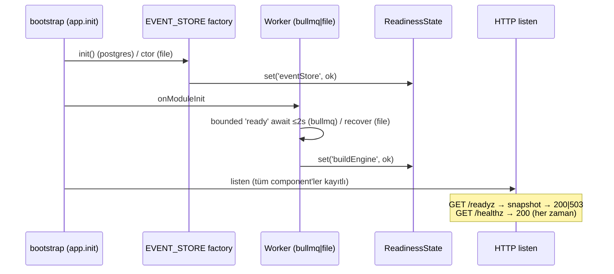

# Hardening: Readiness + Throttler Lua Atomicity — Design

- **Tarih:** 2026-11-25
- **Durum:** Tasarım onaylandı (konsolide) → spec commit bekliyor
- **Kapsam:** İki orthogonal hardening kalemi tek fazda (Group F emsali): (H1) RedisThrottlerStorage fixed-window'un Lua script ile atomik increment+expire'a taşınması, (H2) build engine readiness — bounded boot-ready await + `/healthz` (liveness) + `/readyz` (readiness) yüzeyi. F-spec §8'de "Faz-3'te yeniden değerlendir" denilen iki seam'in kapanışı.
- **Kapsam-dışı:** request-gating (degraded'de build POST 503), EVALSHA/defineCommand, readiness'a throttler/registry component'i, sites boot-safe değişikliği, OAuth2, registry cache.

## 1. Kararlar (norm-aligned)

| # | Karar | Seçim | Gerekçe / norm |
|---|-------|-------|----------------|
| 1 | Throttler atomiklik | **Tek Lua EVAL** (INCR+PEXPIRE+block tek script) | Rate limiter sektör normu: atomik script. Redis single-threaded script execution → heal/NX crash pencereleri kökten kapanır. Port/guard/config değişmez (D1 seam) |
| 2 | EVALSHA optimizasyonu | **YOK (plain EVAL)** | Küçük script, her istekte tek EVAL; SHA cache throughput gerekirse sonraki faz (YAGNI) |
| 3 | Orphan heal (pttl -1) | **Script içinde korunur** | Lua yeni orphan üretemez ama eski deploy'dan kalan TTL'siz key'i kapatır (migration penceresi); 2 satır |
| 4 | Readiness modeli | **Report-only** (gating YOK) | k8s normu: readiness probe state'i raporlar, traffic gating orchestrator'ın işi. Boot-safe "degrade, don't brick" korunur; build POST degraded'de mevcut fail-closed 500 (R11 parity) |
| 5 | Endpoint shape | **`GET /healthz` + `GET /readyz`** | İki ayrı probe sektör normu: liveness (process ayakta, her zaman 200) vs readiness (engine hazır, 200/503). Tek endpoint'te birleştirmek liveness restart-loop anti-pattern'i |
| 6 | Boot promise boşluğu | **BullMqBuildWorker bounded 'ready' await (2s)** | Gerçek boşluk: worker yaratılıyor ama 'ready' beklenmeden listen dönüyor. Bounded await (boundedGetJob emsali): timeout/down → degraded, boot brick OLMAZ |
| 7 | Public perimeter | **Mevcut mekanizmalar**: POLICY `'public'` + IdentityMiddleware `.exclude('healthz','readyz')` | GET zaten throttle-exempt (AgentThrottlerGuard.shouldSkip). Probe'lar token taşımaz → identity muafiyeti şart; policy'de 'public' deseni mevcut |
| 8 | State sahibi | **`ReadinessState` @Global HealthModule** | Nötr cross-module konum (redis-connection emsali); builds inject eder. Component map: `eventStore`, `buildEngine` |
| 9 | Worker inject | **`@Optional() readiness?: ReadinessState`** | Mevcut unit testler worker'ları doğrudan kuruyor → constructor parity korunur; readiness opsiyonel telemetri |
| 10 | PG-degraded testi | **Factory-seviyesi** (export edilen eventStoreProvider) | Sites postgres factory init catch'siz → PG-down full boot brick olur (mevcut davranış, kapsam-dışı). ES factory catch'li → seam testi doğru seviye |

## 2. Mimari

### H1 — Lua atomicity

**MODIFIED `backend/src/security/infrastructure/redis-throttler.storage.ts`:** `increment` gövdesi tek `EVAL`'e iner. `waitReady`, `onApplicationShutdown`, key formatı (`throttler:${name}:${key}` + `:block`), dönüş shape'i ve saniye dönüşümü (I2: `Math.ceil(ms/1000)`) aynen kalır.

```lua
-- KEYS[1]=hit key, KEYS[2]=block key; ARGV[1]=ttl, ARGV[2]=limit, ARGV[3]=blockDuration (ms)
local blockTtl = redis.call('PTTL', KEYS[2])
if blockTtl > 0 then                          -- I1 parity: blocked → freeze-hits, INCR YOK
  local hits = redis.call('GET', KEYS[1])
  local pttl = redis.call('PTTL', KEYS[1])
  return { tonumber(hits) or 0, pttl > 0 and pttl or tonumber(ARGV[1]), 1, blockTtl }
end
local total = redis.call('INCR', KEYS[1])     -- atomik: INCR↔PEXPIRE crash penceresi yok
if total == 1 then redis.call('PEXPIRE', KEYS[1], ARGV[1]) end
local pttl = redis.call('PTTL', KEYS[1])
if pttl == -1 then                            -- legacy orphan heal (karar 3)
  redis.call('PEXPIRE', KEYS[1], ARGV[1]); pttl = redis.call('PTTL', KEYS[1])
end
if total > tonumber(ARGV[2]) then
  redis.call('SET', KEYS[2], '1', 'PX', ARGV[3], 'NX')   -- set-once, non-sliding
  return { total, pttl > 0 and pttl or tonumber(ARGV[1]), 1, tonumber(ARGV[3]) }
end
return { total, pttl > 0 and pttl or tonumber(ARGV[1]), 0, 0 }
```

TS çağrısı ve dönüşüm:

```ts
const [totalHits, pttlMs, blocked, blockMs] = (await this.redis.eval(
  LUA_INCREMENT, 2, redisKey, blockKey, ttl, limit, blockDuration,
)) as [number, number, number, number];
return {
  totalHits,
  timeToExpire: Math.ceil(pttlMs / 1000),
  isBlocked: blocked === 1,
  timeToBlockExpire: Math.ceil(blockMs / 1000),
};
```

Parity notları: frozen branch'te `timeToBlockExpire = ceil(blockTtl/1000)` (kalan süre); yeni block'ta `ceil(blockDuration/1000)` (SET NX kazanmasa da — mevcut kodla birebir). `tonumber(false)` → nil → `or 0` (missing GET). Script içi pttl fallback'leri (`>0 ? pttl : ttl`) mevcut TS fallback'lerinin birebir karşılığı.

### H2 — Readiness

**YENİ `backend/src/health/readiness-state.ts`:**

```ts
export type ComponentStatus = 'ready' | 'degraded';
export interface ReadinessSnapshot { status: 'ready' | 'degraded'; components: Record<string, ComponentStatus>; }

@Injectable()
export class ReadinessState {
  private readonly components = new Map<string, ComponentStatus>();
  set(name: string, ok: boolean): void { this.components.set(name, ok ? 'ready' : 'degraded'); }
  snapshot(): ReadinessSnapshot {
    const components = Object.fromEntries(this.components);
    const ready = [...this.components.values()].every((s) => s === 'ready');
    return { status: ready ? 'ready' : 'degraded', components };
  }
}
```

Boş map → `every()` vacuous-true → ready. Boot sırası garantiler: tüm provider'lar `onModuleInit`/factory'de (listen ÖNCESİ) component kaydeder; HTTP serve başladığında map doludur.

**YENİ `backend/src/health/health.controller.ts`:**

```ts
@Controller()
export class HealthController {
  constructor(private readonly readiness: ReadinessState) {}
  @Get('healthz') healthz(): { status: string } { return { status: 'ok' }; }
  @Get('readyz') readyz(): ReadinessSnapshot {
    const snap = this.readiness.snapshot();
    if (snap.status !== 'ready') throw new ServiceUnavailableException(snap); // 503 + body
    return snap;
  }
}
```

**YENİ `backend/src/health/health.module.ts`:** `@Global() @Module({ controllers: [HealthController], providers: [ReadinessState], exports: [ReadinessState] })`.

**MODIFIED `backend/src/app.module.ts`:** imports += `HealthModule`.

**MODIFIED `backend/src/security/security.module.ts` configure:**

```ts
consumer.apply(HostMiddleware).forRoutes('*');
consumer.apply(IdentityMiddleware).exclude('healthz', 'readyz').forRoutes('*');
```

HostMiddleware health dahil tüm route'larda kalır (host doğrulaması probe'a da uygulanır).

**MODIFIED `backend/src/security/interface/policy.ts`:** `'GET healthz': 'public'`, `'GET readyz': 'public'`. PermissionGuard `perm === 'public'` → agent'a dokunmadan true (mevcut satır 22); identity exclude edildiği için `req.agent` undefined olsa da güvenli.

**MODIFIED `backend/src/builds/builds.module.ts`:** `eventStoreProvider` named export olur (karar 10 seam testi). Factory `ReadinessState` inject eder:
- postgres: `await store.init()` başarı → `set('eventStore', true)`; mevcut catch → warn + `set('eventStore', false)` (boot-safe değişmez).
- file: `set('eventStore', true)` (FileEventStore ctor fail etmez).

**MODIFIED `backend/src/builds/infrastructure/bullmq/bullmq-build-worker.ts`:**
- ctor += `@Optional() private readonly readiness?: ReadinessState`.
- `onModuleInit`: local `ok = true` flag; worker yaratıldıktan sonra **bounded 'ready' await** (aşağıda) aynı try içinde; init catch → warn + `ok = false`. Recover try/catch: recover catch → warn + `ok = false`. İki fazın sonunda **tek** `set('buildEngine', ok)` — init başarısız + recover başarılı kombinasyonu ready RAPORLAMAZ (overwrite yok).
- Bounded await (waitReady/boundedGetJob emsali — handle'lı, unref'li, boot-safe):

```ts
private waitWorkerReady(timeoutMs = 2000): Promise<void> {
  if (this.connection?.status === 'ready') return Promise.resolve();
  return new Promise<void>((resolve, reject) => {
    const onReady = () => { clearTimeout(timer); resolve(); };
    const timer = setTimeout(() => {
      this.worker?.off('ready', onReady);
      reject(new Error('bullmq worker ready timeout'));
    }, timeoutMs);
    timer.unref();
    this.worker?.once('ready', onReady);
  });
}
```

Timeout/down → onModuleInit catch → degraded + warn; app boot eder (sites çalışır). Redis-down boot testi +2s uzar (bounded timeout — kabul).

**MODIFIED `backend/src/builds/application/build-worker.ts`:** ctor += `@Optional() readiness?: ReadinessState`; `onModuleInit` recover try → `set('buildEngine', true)`, catch → warn + `set('buildEngine', false)`.

### Boot akışı (mermaid)



## 3. Data flow

- **Normal boot (file):** ES factory ready → BuildWorker.recover → ready → listen → `/readyz` 200 `{status:'ready',components:{eventStore:'ready',buildEngine:'ready'}}`.
- **Normal boot (bullmq+Redis up):** worker 'ready' ≤2s → recover → ready → listen → 200.
- **Degrade boot (bullmq+Redis down):** worker ready timeout → warn + degraded → recover best-effort (boundedGetJob skip) → listen → `/readyz` 503, `GET /sites` 200, build POST → dispatch fail → 500 (R11, değişmez).
- **Throttler istek:** guard → `increment` → waitReady → tek EVAL → atomik {hits, pttl, blocked, blockMs} → saniye dönüşümü → guard header'ları (I2 raw).

## 4. Error / parity tablosu

| Durum | Davranış | Değişim |
|-------|----------|---------|
| Redis down, throttler | waitReady 2s timeout → throw → 500 fail-closed | YOK |
| Blocked retry | freeze-hits, block TTL uzamaz (script içi early-return + NX) | YOK (parity suite kanıt) |
| TTL'siz legacy orphan | script içi heal | YOK (taşındı) |
| Concurrent first-over-limit | tek SET NX, TTL reset yok | YOK (artık script atomikliğinde) |
| Redis down, bullmq boot | brick olmaz; +2s bounded ready timeout; readyz 503 | boot-safe korundu, readiness görünür |
| PG down, ES init | warn + devam; readyz 503 eventStore degraded | boot-safe korundu |
| PG down, sites (postgres mode) | boot brick (mevcut) | YOK — kapsam-dışı |
| Health route, token mode, bearer'sız | 200 (identity exclude + policy public) | YENİ public yüzey |
| Health route, throttler | GET exempt | YOK |
| Build POST degraded | 500 fail-closed (R11) | YOK |

## 5. Testing

- **H1 bracket:** mevcut `redis-throttler.spec.ts`'in 8 testi **DEĞİŞMEDEN** geçer (skip-gated Redis). NX concurrency testi seam uyarlaması: client-side `set` monkey-patch Lua'da çalışmaz (SET script içinde) → seam `eval`'e taşınır (ikinci EVAL 250ms gecikir); davranış assertion'ları **birebir aynı** (set-once, TTL reset yok). Bu uyarlama eski implementasyona karşı genuine-red üretir (seam ölür → TTL assertion fail).
- **H1 yeni:** concurrent first-hit burst — `Promise.all` 20 `increment` (aynı key, limit 100 → block yok) → ardından tek `increment` → totalHits **tam 21** (Kayıp INCR yok), TTL > 0, tek window (atomiklik kanıtı).
- **H2 unit:** `readiness-state.spec.ts` — set/snapshot, tek degraded → status degraded, boş map → ready, component map doğruluğu.
- **H2 http (file, infra'sız):** `health.http.spec.ts` — healthz 200; readyz 200 + components; token mode'da bearer'sız healthz/readyz 200 (public), bearer'sız `GET /sites` hâlâ 401 (perimeter intact); HostMiddleware health'te aktif.
- **H2 bullmq (skip-gated Redis):** Redis up → readyz 200 her iki component ready; Redis down (unreachable URL) → boot brick olmaz + readyz 503 buildEngine degraded + `GET /sites` 200.
- **H2 ES factory seam:** export edilen `eventStoreProvider.useFactory(badUrl, readiness)` → store döner + eventStore degraded (throw YOK); file factory → ready.
- **Regression bracket:** tüm mevcut suite (build-worker/bullmq/shutdown/sites/security parity) değişmeden geçer; `@Optional()` ctor parity kanıtı.

## 6. YAGNI (bu fazda YOK)

- Request-gating / 503 build POST (R11 parity kırar; gating orchestrator işi)
- EVALSHA / defineCommand cache
- Readiness'a throttler-redis / registry component'i (set API genişlemeye açık)
- Ayrı export edilmiş boot promise (`app.init()` zaten promise; bounded await boşluğu kapatır)
- Sites postgres boot-safe (ayrı borç, bu fazın konusu değil)
- `/metrics`, detaylı health versiyon/build-info body

## 7. Kabul kriterleri

1. `RedisThrottlerStorage.increment` tek Lua EVAL; 8 parity testi değişmeden + NX testi seam-uyarlamasıyla (assertion'lar aynı) yeşil.
2. Concurrent burst testi: tam sayım + tek TTL (atomiklik kanıtı).
3. `GET /healthz` her boot modunda 200; `GET /readyz` ready boot'ta 200, degrade boot'ta 503 + component body.
4. Health route'ları token mode'da bearer'sız 200; diğer route'ların perimeter'ı değişmez.
5. BullMQ worker 'ready' bounded await: Redis-up boot'ta listen öncesi ready; Redis-down boot brick olmaz (+≤2s).
6. Boot-safe degrade korunur: Redis-down'da sites API 200, build POST 500 (R11).
7. Mevcut worker unit testleri `@Optional()` sayesinde değişmeden geçer.
8. README + roadmap güncel; final bracket yeşil (Docker'lı + Docker'sız).

## 8. Tradeoff tablosu

| Karar | Seçilen | Alternatif | Tradeoff |
|-------|---------|------------|----------|
| Atomiklik | Lua EVAL | NX/heal koru / MULTI-WATCH | kökten pencere kapanışı vs 2 satır heal migration koruması; MULTI optimistic retry karmaşık |
| Readiness | report-only | request-gating 503 | parity korunur vs degraded'de "dürüst" 503; gating orchestrator normu |
| Endpoint | healthz+readyz ayrı | tek /healthz | liveness/readiness ayrımı norm vs tek yüzey basitlik |
| Boot await | bounded 2s | süresiz await / await yok | boot-safe + deterministik listen vs Redis-down +2s boot |
| State yeri | @Global HealthModule | builds içi / infra | nötr cross-module vs modül bağımlılığı |
| PG-degraded test | factory seam | full-boot bad-URL | sites brick (mevcut) doğru seviyede test vs kapsam genişletme |

## 9. Ölçeklenebilirlik fazları

- **Şimdi:** 2 component (eventStore, buildEngine), plain EVAL, tek instance probe.
- **Sonra (talep gelirse):** EVALSHA cache (throughput), readiness'a registry/throttler component, orchestrator (k8s) probe entegrasyonu, multi-instance'da instance-başı readyz (zaten instance-local state).